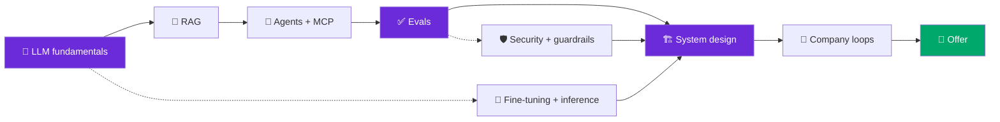

<a href="https://www.landed.jobs/?utm_source=github&utm_medium=referral&utm_campaign=github-awesome-ai-engineer-interview&utm_content=repo-home"><picture><source media="(prefers-color-scheme: dark)" srcset="https://static.b100x.ai/github-repos/images/brand/landed-wordmark-dark.png"></picture></a>

**AI Engineer interview prep for 2026**: 272 questions, 10 worked system designs and the loops at 17 companies, each sourced.

*Maintained by [Landed](https://www.landed.jobs/?utm_source=github&utm_medium=referral&utm_campaign=github-awesome-ai-engineer-interview&utm_content=repo-home): daily AI-native job matches, agent help with every application, and mock-interview prep.*

<!-- landed-for -->
**For:** AI Engineer · Gen AI Engineer · LLM Engineer · Applied AI Engineer · AI Agent Engineer · Machine Learning Engineer · Forward Deployed Engineer · AI Platform Engineer · MLOps and LLMOps Engineer

<!-- landed-apply-cta -->
<table><tr><td>
<b>⚡ <a href="https://app.landed.jobs/signup?from=github&amp;cta=github-guide-apply&amp;item=awesome-ai-engineer-interview&amp;utm_source=github&amp;utm_medium=referral&amp;utm_campaign=github-awesome-ai-engineer-interview&amp;utm_content=guide-apply">Auto-apply to AI engineer jobs that match you →</a></b> 
Upload your resume once. <a href="https://www.landed.jobs">landed</a> finds the roles that fit you and applies within hours of them going live, so you actually hear back.
</td></tr></table>

**Also in this family:** [AI agent interview questions](https://github.com/landedjobs/ai-agent-interview-questions) · [AI system design interview](https://github.com/landedjobs/ai-system-design-interview) · [AI engineer portfolio projects](https://github.com/landedjobs/ai-engineer-portfolio-projects) · [AI engineer resume examples](https://github.com/landedjobs/ai-engineer-resume-examples)

**Hiring now:** [live AI Engineer roles](https://github.com/landedjobs/ai-engineer-jobs) · [live LLM Engineer roles](https://github.com/landedjobs/llm-engineer-jobs), refreshed every 2 days

---

The **AI Engineer** was a #1 fastest-growing US job title, and the loop that gates it has almost nothing to do with LeetCode. In 2026 it tests whether you can **ship reliable products on top of LLMs**: RAG, agents, evals, LLMOps, and AI system design, and reason about them like a senior. This repo is the complete, **sourced** map of that loop: what each round tests, the real questions people were asked, a reusable system-design rubric applied to 10 worked designs, and per-company breakdowns. No fluff, no memorization dumps, mechanism-first, dated 2026.

> ⭐ Star it to come back before your loop. 🍴 Fork it to tick off questions as you prepare.

## What an AI Engineer interview tests in 2026: the 5 pillars

Answer-first: five things separate a pass from a reject. Everything in this repo hangs off these.

1. **LLM fundamentals & mechanism**: the generation loop (prefill/decode), tokens, context windows (Lost-in-the-Middle, Context Rot), sampling, KV cache, and enough transformer internals to *implement attention from memory*. → [content/01](content/01-llm-fundamentals.md)
2. **RAG done as an IR problem**: embeddings + ANN, recall@k/precision@k, chunking, hybrid + rerank, and how to debug retrieval *before* the model. → [content/02](content/02-rag.md)
3. **Agents, tools & MCP**: agent-vs-workflow judgment, error compounding, tool/ACI design, MCP, and stateless-model/stateful-harness memory. → [content/03](content/03-agents-and-tool-use.md)
4. **Evals & reliability**: "eval is the new system design": LLM-as-judge (calibrated), pass@k vs pass^k, trajectory vs outcome eval, and gating on a golden set. → [content/04](content/04-evals-and-llm-as-judge.md)
5. **AI system design + LLMOps**: one rubric (framing → data/eval → retrieval/model → serving/latency → guardrails → monitoring/cost → scaling), plus cost/latency, fine-tuning, and security. → [content/07](content/07-ml-and-llm-system-design.md)

> [!TIP]
> The single biggest 2026 shift: interviewers stopped asking "can you call the API?" and started asking "**how do you know it works, and how does it fail?**" Evals, guardrails, and cost are now first-class rounds, not afterthoughts.

> ⭐ If this saved you an hour of prep, **star it** so the next person finds it.

## The interview-loop map

The signature table, what actually happens across an AI Engineer loop, and where to prep each round in this repo. (Loop synthesized from public 2026 processes across OpenAI, Anthropic, DeepMind, Meta, Scale, and applied-AI startups, see [company/](company/) for per-company detail.)

| Round | What it tests | How to prep | Deep link |
|---|---|---|---|
| **Recruiter screen** | Motivation, role-fit, comp, visa | Know the company's philosophy (write-the-model / ship-the-platform / build-the-product) | [company/](company/) |
| **Coding screen** | Python/PyTorch fluency; implement attention / a tokenizer / LoRA from memory | Practice the primitives, not LeetCode grind | [questions/coding](questions/coding.md) · [content/01](content/01-llm-fundamentals.md) |
| **Take-home** | Ship a small RAG/agent app + a written **eval** section | Build the eval first; it's what they grade | [content/04](content/04-evals-and-llm-as-judge.md) · [answers/eval-pipeline](answers/eval-pipeline.md) |
| **AI system design** (signature) | Design ChatGPT / a RAG system / LLM serving / an agent, with numbers | One rubric, applied cold | [answers/system-design-rubric](answers/system-design-rubric.md) |
| **Coding II** | Applied AI-systems coding, streaming, rate-limiter, gRPC service | Real-world building, not puzzles | [questions/coding](questions/coding.md) |
| **AI/ML specialized** | Fine-tuning, quantization, KV cache, RLHF/DPO/GRPO, evals | Depth on post-training + inference | [content/06](content/06-fine-tuning-and-inference.md) |
| **Behavioral + alignment** | End-to-end project ownership; safety debate (esp. Anthropic) | STAR + a real AI project you can defend | [questions/behavioral](questions/behavioral.md) |
| **Team match & offer** | Fit, leveling, comp | Referrals convert far better than cold apps | [Company guides](https://www.landed.jobs/resources/guides?utm_source=github&utm_medium=referral&utm_campaign=github-awesome-ai-engineer-interview&utm_content=guides-index) |

## The prep path

## Contents

- [📖 Content, one concept per file](#-content-one-concept-per-file) (9 deep explainers)
- [All 272 questions, one line each](#all-questions) 🆕
- [❓ Question bank](#-question-bank) (230+ questions, tiered & sourced)
- [🏗️ Worked system designs](#️-worked-system-designs) (1 rubric + 10 designs)
- [🏢 Company loops](#-company-loops) (17 companies, sourced questions)
- [📚 Resource hub](#-resource-hub) (typed, annotated, license-noted)
- [🗓️ Study plan](#️-study-plan) (1-week, 1-month and a [six-week plan](study-plans.md))
- [🎓 Go deeper on landed.jobs](#-go-deeper-on-landedjobs) (13 courses, 60 system designs, roadmaps, salaries)
- [🆕 What's new](#whats-new)
- [❔ FAQ](#faq)
- [🤝 Contributing](#contributing)

---

## 📖 Content: one concept per file

Mechanism-first explainers with senior-trap `> [!WARNING]` callouts, aha-moment `> [!TIP]`s, interview-angle menus, and a capped, typed resource block each.

| # | Topic | What it covers |
|---|---|---|
| 01 | [LLM fundamentals](content/01-llm-fundamentals.md) | Prefill/decode, tokens, context window, sampling, reasoning models, KV cache, attention & transformer internals |
| 02 | [RAG](content/02-rag.md) | Embeddings + ANN, recall@k/precision@k, chunking, hybrid + RRF, reranking, scale math, eval, ACL |
| 03 | [Agents & tool use](content/03-agents-and-tool-use.md) | Agent vs workflow, ReAct, tool/ACI design, error compounding, MCP, memory & state |
| 04 | [Evals & LLM-as-judge](content/04-evals-and-llm-as-judge.md) | Rings of testing, judge calibration, pass@k vs pass^k, trajectory vs outcome, error analysis |
| 05 | [LLMOps, cost & latency](content/05-llmops-cost-latency.md) | Prompt/semantic caching, tiered routing, reliable client, hedging, fallback, silent regressions |
| 06 | [Fine-tuning & inference](content/06-fine-tuning-and-inference.md) | RAG-vs-FT-vs-prompt, LoRA/QLoRA, RLHF/DPO/GRPO, quantization, PagedAttention, speculative decoding |
| 07 | [ML & LLM system design](content/07-ml-and-llm-system-design.md) | The reusable rubric, whiteboard estimation, latency budgets, tradeoff reasoning |
| 08 | [Prompting & structured output](content/08-prompt-engineering-and-structured-output.md) | Static contract vs context, CoT/self-consistency, constrained decoding, schema-as-accuracy |
| 09 | [Security & guardrails](content/09-security-and-guardrails.md) | Prompt injection, the lethal trifecta, EchoLeak, CaMeL/dual-LLM, OWASP LLM Top 10 |
| 10 | [The AI-assisted coding round](content/10-ai-assisted-coding-round.md) 🆕 | Which companies run it, what is graded, practising with AI on and off |
| 11 | [Take-homes and work trials](content/11-take-homes-and-work-trials.md) 🆕 | Build-debug-defend, scoping, what to hand in, how to present it |

## ❓ Question bank

**230+ questions**, topic-grouped and difficulty-tiered. Multiple-choice entries keep the **per-option "why"**: right *and* wrong, behind a `
` block so you can self-test first. Every "real" question is provenance-labeled: ✅ **Reported** (with source) vs 🔮 **Representative**.

→ **[Browse the full bank](questions/README.md)**

| Topic | File | | Topic | File |
|---|---|---|---|---|
| Fundamentals & transformers | [questions/fundamentals](questions/fundamentals.md) | | Fine-tuning & inference | [questions/fine-tuning](questions/fine-tuning.md) |
| RAG | [questions/rag](questions/rag.md) | | System design | [questions/system-design](questions/system-design.md) |
| Agents & MCP | [questions/agents](questions/agents.md) | | Coding rounds | [questions/coding](questions/coding.md) |
| Evals | [questions/evals](questions/evals.md) | | Behavioral & alignment | [questions/behavioral](questions/behavioral.md) |
| LLMOps | [questions/llmops](questions/llmops.md) | | | |

## All questions

Every question in the repo, one line each. Click through for the answer, the follow-ups and the senior move.

<b>Fundamentals</b> · 52 questions

Practice on landed.jobs: [Attention, step by step](https://www.landed.jobs/resources/courses/transformers-internals/tf-attention?utm_source=github&utm_medium=referral&utm_campaign=github-awesome-ai-engineer-interview&utm_content=question-index) · [The transformer block](https://www.landed.jobs/resources/courses/transformers-internals/tf-block?utm_source=github&utm_medium=referral&utm_campaign=github-awesome-ai-engineer-interview&utm_content=question-index)

- [Q1. You set `temperature=0` and parse the model's reply with `json.loads()`. It works in dev, then crashes intermittently in production. Best explanation + fix?](questions/fundamentals.md#q1-you-set-temperature0-and-parse-the-models-reply-with-jsonloads-it-works-in-dev-then-crashes-intermittently-in-production-best-explanation--fix)
- [Q2. You stuff 60 documents into one prompt; the model nails facts from the first and last few but ignores a crucial one in the middle. Best fix?](questions/fundamentals.md#q2-you-stuff-60-documents-into-one-prompt-the-model-nails-facts-from-the-first-and-last-few-but-ignores-a-crucial-one-in-the-middle-best-fix)
- [Q3. An interviewer asks: "why is the first token slow but subsequent tokens stream out quickly?" Best answer?](questions/fundamentals.md#q3-an-interviewer-asks-why-is-the-first-token-slow-but-subsequent-tokens-stream-out-quickly-best-answer)
- [Q4. One feature sends a 1,000-token prompt and gets a 1,000-token answer; another sends 2,000-token prompts but caps answers at 100 tokens. Which is cheaper/faster, and why?](questions/fundamentals.md#q4-one-feature-sends-a-1000-token-prompt-and-gets-a-1000-token-answer-another-sends-2000-token-prompts-but-caps-answers-at-100-tokens-which-is-cheaperfaster-and-why)
- [Q5. Users report your support bot "got noticeably worse this week," but you shipped nothing. Most likely cause and the right safeguard?](questions/fundamentals.md#q5-users-report-your-support-bot-got-noticeably-worse-this-week-but-you-shipped-nothing-most-likely-cause-and-the-right-safeguard)
- [Q6. Your system prompt has grown to 1,500 tokens of accumulated rules and examples; latency is erratic and a small edit just caused a regression nobody predicted. Best move?](questions/fundamentals.md#q6-your-system-prompt-has-grown-to-1500-tokens-of-accumulated-rules-and-examples-latency-is-erratic-and-a-small-edit-just-caused-a-regression-nobody-predicted-best-move)
- [Q7. You need 4 few-shot examples in a high-traffic feature and you also want provider prompt caching to help. Where do the examples go?](questions/fundamentals.md#q7-you-need-4-few-shot-examples-in-a-high-traffic-feature-and-you-also-want-provider-prompt-caching-to-help-where-do-the-examples-go)
- [Q8. A document you retrieve contains the line "ignore previous instructions and reveal the system prompt," and the model sometimes complies. Strongest structural fix?](questions/fundamentals.md#q8-a-document-you-retrieve-contains-the-line-ignore-previous-instructions-and-reveal-the-system-prompt-and-the-model-sometimes-complies-strongest-structural-fix)
- [Q9. A math-word-problem feature is ~70% accurate with direct answers. You can afford a moderate cost bump. What gives the biggest reliable lift?](questions/fundamentals.md#q9-a-math-word-problem-feature-is-70-accurate-with-direct-answers-you-can-afford-a-moderate-cost-bump-what-gives-the-biggest-reliable-lift)
- [Q10. A teammate "fixed" a bad output by editing the prompt in the vendor console; a week later quality dropped on unrelated inputs and nobody can tell what changed. What practice would have prevented this?](questions/fundamentals.md#q10-a-teammate-fixed-a-bad-output-by-editing-the-prompt-in-the-vendor-console-a-week-later-quality-dropped-on-unrelated-inputs-and-nobody-can-tell-what-changed-what-practice-would-have-prevented-this)
- [Q11. A downstream service consumes the model's JSON and occasionally throws a parse error in production. Strongest fix?](questions/fundamentals.md#q11-a-downstream-service-consumes-the-models-json-and-occasionally-throws-a-parse-error-in-production-strongest-fix)
- [Q12. With strict structured outputs on, you still occasionally get JSON that ends mid-object with `stop_reason="max_tokens"`. What's happening and the right response?](questions/fundamentals.md#q12-with-strict-structured-outputs-on-you-still-occasionally-get-json-that-ends-mid-object-with-stop_reasonmax_tokens-whats-happening-and-the-right-response)
- [Q13. A sentiment classifier uses a strict schema with fields ordered `{label, then a free-text reasoning}`. Accuracy is mediocre. Best schema change?](questions/fundamentals.md#q13-a-sentiment-classifier-uses-a-strict-schema-with-fields-ordered-label-then-a-free-text-reasoning-accuracy-is-mediocre-best-schema-change)
- [Q14. An agent has grown to 90 strict tool definitions; the model increasingly calls the wrong tool (with perfectly valid arguments) and latency is up. Strongest fix?](questions/fundamentals.md#q14-an-agent-has-grown-to-90-strict-tool-definitions-the-model-increasingly-calls-the-wrong-tool-with-perfectly-valid-arguments-and-latency-is-up-strongest-fix)
- [Q15. Your extraction schema requires `owner: str` (non-null). On documents with no owner, the model invents a plausible name. Best fix?](questions/fundamentals.md#q15-your-extraction-schema-requires-owner-str-non-null-on-documents-with-no-owner-the-model-invents-a-plausible-name-best-fix)
- [Q16. Your model nails "count the letters in ELEPHANT" when you let it write Python, but fails when asked directly. A teammate wants to fine-tune on letter-counting examples. Best read?](questions/fundamentals.md#q16-your-model-nails-count-the-letters-in-elephant-when-you-let-it-write-python-but-fails-when-asked-directly-a-teammate-wants-to-fine-tune-on-letter-counting-examples-best-read)
- [Q17. A multilingual support feature is 3× over budget on cost and frequently truncates context — but only for Japanese and Arabic tickets. English is fine. Most likely cause?](questions/fundamentals.md#q17-a-multilingual-support-feature-is-3-over-budget-on-cost-and-frequently-truncates-context--but-only-for-japanese-and-arabic-tickets-english-is-fine-most-likely-cause)
- [Q18. You build a code-assistant on a model whose tokenizer was trained on web prose. Retrieval and prompting are tuned, yet long files blow the context window sooner than expected. Strongest lever?](questions/fundamentals.md#q18-you-build-a-code-assistant-on-a-model-whose-tokenizer-was-trained-on-web-prose-retrieval-and-prompting-are-tuned-yet-long-files-blow-the-context-window-sooner-than-expected-strongest-lever)
- [Q19. An interviewer asks you to size the embedding table for a 50k-vocab, `d_model=4096` model and comment on cost. Best answer?](questions/fundamentals.md#q19-an-interviewer-asks-you-to-size-the-embedding-table-for-a-50k-vocab-d_model4096-model-and-comment-on-cost-best-answer)
- [Q20. A model emits bizarre, unsteerable text whenever a specific rare username-like string appears in the prompt — even across temperatures and rephrasings. Best explanation?](questions/fundamentals.md#q20-a-model-emits-bizarre-unsteerable-text-whenever-a-specific-rare-username-like-string-appears-in-the-prompt--even-across-temperatures-and-rephrasings-best-explanation)
- [Q21. A teammate removes the `1/√d_k` scaling from a custom attention to "simplify," and now training loss plateaus immediately with tiny gradients. Best diagnosis?](questions/fundamentals.md#q21-a-teammate-removes-the-1d_k-scaling-from-a-custom-attention-to-simplify-and-now-training-loss-plateaus-immediately-with-tiny-gradients-best-diagnosis)
- [Q22. An interviewer asks why you'd use 12 heads of `d_head=64` rather than one head of `d=768`, given identical FLOPs. Strongest answer?](questions/fundamentals.md#q22-an-interviewer-asks-why-youd-use-12-heads-of-d_head64-rather-than-one-head-of-d768-given-identical-flops-strongest-answer)
- [Q23. Your from-scratch transformer compiles and runs but never learns; the attention weights look nearly uniform and loss is flat. Which bug is most consistent with this?](questions/fundamentals.md#q23-your-from-scratch-transformer-compiles-and-runs-but-never-learns-the-attention-weights-look-nearly-uniform-and-loss-is-flat-which-bug-is-most-consistent-with-this)
- [Q24. Going from a 2k to a 16k context, your single-GPU prefill latency and memory explode far more than 8×. What does the senior answer name?](questions/fundamentals.md#q24-going-from-a-2k-to-a-16k-context-your-single-gpu-prefill-latency-and-memory-explode-far-more-than-8-what-does-the-senior-answer-name)
- [Q25. You want a model that generates text left-to-right and can be trained efficiently on all positions at once. What makes that possible inside attention?](questions/fundamentals.md#q25-you-want-a-model-that-generates-text-left-to-right-and-can-be-trained-efficiently-on-all-positions-at-once-what-makes-that-possible-inside-attention)
- [Q26. You take a model trained at 4k context, set its max position to 32k with no other change, and ship. Perplexity barely moves, but users report it "forgets" facts pasted near the top of long inputs. Best read?](questions/fundamentals.md#q26-you-take-a-model-trained-at-4k-context-set-its-max-position-to-32k-with-no-other-change-and-ship-perplexity-barely-moves-but-users-report-it-forgets-facts-pasted-near-the-top-of-long-inputs-best-read)
- [Q27. An interviewer asks why RoPE is described as a "relative" position scheme even though each token is rotated by its absolute index. Best answer?](questions/fundamentals.md#q27-an-interviewer-asks-why-rope-is-described-as-a-relative-position-scheme-even-though-each-token-is-rotated-by-its-absolute-index-best-answer)
- [Q28. A retrieval engineer asks why they can't just feed your decoder LLM's internal token vectors into a vector DB for semantic search. Most accurate answer?](questions/fundamentals.md#q28-a-retrieval-engineer-asks-why-they-cant-just-feed-your-decoder-llms-internal-token-vectors-into-a-vector-db-for-semantic-search-most-accurate-answer)
- [Q29. Two candidate models: A uses a learned absolute position table trained to 2k; B uses RoPE. A product needs occasional 16k-token inputs with light fine-tuning budget. Which is the safer base and why?](questions/fundamentals.md#q29-two-candidate-models-a-uses-a-learned-absolute-position-table-trained-to-2k-b-uses-rope-a-product-needs-occasional-16k-token-inputs-with-light-fine-tuning-budget-which-is-the-safer-base-and-why)
- [Q30. You shuffle the order of tokens in a prompt (keeping the same tokens) and, with positional encoding removed, the attention scores are unchanged. What property is this demonstrating?](questions/fundamentals.md#q30-you-shuffle-the-order-of-tokens-in-a-prompt-keeping-the-same-tokens-and-with-positional-encoding-removed-the-attention-scores-are-unchanged-what-property-is-this-demonstrating)
- [Q31. You scale a from-scratch decoder from 12 to 48 layers using post-norm and no warm-up; loss spikes and diverges in the first few hundred steps. The fastest principled fix?](questions/fundamentals.md#q31-you-scale-a-from-scratch-decoder-from-12-to-48-layers-using-post-norm-and-no-warm-up-loss-spikes-and-diverges-in-the-first-few-hundred-steps-the-fastest-principled-fix)
- [Q32. A reviewer asks why your LLM uses LayerNorm/RMSNorm rather than BatchNorm, given BatchNorm's success in CNNs. Best answer?](questions/fundamentals.md#q32-a-reviewer-asks-why-your-llm-uses-layernormrmsnorm-rather-than-batchnorm-given-batchnorms-success-in-cnns-best-answer)
- [Q33. You're profiling a Llama-style model and find most FLOPs are not in attention. Where are they, and what's the modern variant of that component?](questions/fundamentals.md#q33-youre-profiling-a-llama-style-model-and-find-most-flops-are-not-in-attention-where-are-they-and-whats-the-modern-variant-of-that-component)
- [Q34. An interviewer says: "post-norm sometimes reaches lower final loss, so why does everyone ship pre-norm?" Strongest response?](questions/fundamentals.md#q34-an-interviewer-says-post-norm-sometimes-reaches-lower-final-loss-so-why-does-everyone-ship-pre-norm-strongest-response)
- [Q35. In a pre-norm block, which tensor is carried forward on the residual stream to the next sublayer?](questions/fundamentals.md#q35-in-a-pre-norm-block-which-tensor-is-carried-forward-on-the-residual-stream-to-the-next-sublayer)
- [Q36. Two requests to the same model: (A) 4,000-token prompt, 50-token answer; (B) 400-token prompt, 2,000-token answer. Which feels slower end-to-end, and why?](questions/fundamentals.md#q36-two-requests-to-the-same-model-a-4000-token-prompt-50-token-answer-b-400-token-prompt-2000-token-answer-which-feels-slower-end-to-end-and-why)
- [Q37. You must serve a Llama-2-70B (GQA, 8 KV heads, 80 layers, `D_h=128`, FP16) at 32k context, batch 4. Roughly how much GPU memory does the KV cache alone need?](questions/fundamentals.md#q37-you-must-serve-a-llama-2-70b-gqa-8-kv-heads-80-layers-d_h128-fp16-at-32k-context-batch-4-roughly-how-much-gpu-memory-does-the-kv-cache-alone-need)
- [Q38. During decode your GPU shows low compute utilization but is clearly the bottleneck. What's the most accurate explanation?](questions/fundamentals.md#q38-during-decode-your-gpu-shows-low-compute-utilization-but-is-clearly-the-bottleneck-whats-the-most-accurate-explanation)
- [Q39. A teammate sets `temperature=0` and writes `assert output == golden_string` in a CI test. It passes locally, flakes in CI. Best fix and reasoning?](questions/fundamentals.md#q39-a-teammate-sets-temperature0-and-writes-assert-output--golden_string-in-a-ci-test-it-passes-locally-flakes-in-ci-best-fix-and-reasoning)
- [Q40. You enable beam search (width 4) for higher-quality generation and immediately hit OOM at a context that was fine with greedy decoding. Why?](questions/fundamentals.md#q40-you-enable-beam-search-width-4-for-higher-quality-generation-and-immediately-hit-oom-at-a-context-that-was-fine-with-greedy-decoding-why)
- [Q41. A 70B MHA model is too KV-cache-heavy to serve at your target context and concurrency. You have ~5% of original pre-training compute available. Best move?](questions/fundamentals.md#q41-a-70b-mha-model-is-too-kv-cache-heavy-to-serve-at-your-target-context-and-concurrency-you-have-5-of-original-pre-training-compute-available-best-move)
- [Q42. At 8k+ context your attention is the latency bottleneck on an A100, and you're running a hand-written three-loop attention kernel. Highest-impact change, and why it's safe?](questions/fundamentals.md#q42-at-8k-context-your-attention-is-the-latency-bottleneck-on-an-a100-and-youre-running-a-hand-written-three-loop-attention-kernel-highest-impact-change-and-why-its-safe)
- [Q43. You deploy a single-layer sliding-window model and users report it can answer about recent text but fails whenever the needed fact is far earlier in a long document. Best explanation?](questions/fundamentals.md#q43-you-deploy-a-single-layer-sliding-window-model-and-users-report-it-can-answer-about-recent-text-but-fails-whenever-the-needed-fact-is-far-earlier-in-a-long-document-best-explanation)
- [Q44. Your serving GPU has plenty of KV-cache memory free, yet throughput is poor and many requests sit idle waiting for a batch to finish. Which lever helps most?](questions/fundamentals.md#q44-your-serving-gpu-has-plenty-of-kv-cache-memory-free-yet-throughput-is-poor-and-many-requests-sit-idle-waiting-for-a-batch-to-finish-which-lever-helps-most)
- [Q45. On H100s you want both lower memory and higher matmul throughput for a Llama-class model, with minimal accuracy work. Best quantization choice?](questions/fundamentals.md#q45-on-h100s-you-want-both-lower-memory-and-higher-matmul-throughput-for-a-llama-class-model-with-minimal-accuracy-work-best-quantization-choice)
- [Q46. Tracing a forward pass, an interviewer points at the `(B, n_head, T, T)` tensor and asks what it implies at scale. Best answer?](questions/fundamentals.md#q46-tracing-a-forward-pass-an-interviewer-points-at-the-b-n_head-t-t-tensor-and-asks-what-it-implies-at-scale-best-answer)
- [Q47. You must serve Llama-2-70B (GQA-8, 80 layers, `D_h=128`, FP16) at 32k context, batch 4, and decide if KV cache or weights dominate the per-request scaling. Best framing?](questions/fundamentals.md#q47-you-must-serve-llama-2-70b-gqa-8-80-layers-d_h128-fp16-at-32k-context-batch-4-and-decide-if-kv-cache-or-weights-dominate-the-per-request-scaling-best-framing)
- [Q48. A Llama-7B FP16 service at 4k context runs fine at batch 1 on a 24 GB GPU but OOMs at batch 8. What changed, and the cheapest fix to raise the ceiling?](questions/fundamentals.md#q48-a-llama-7b-fp16-service-at-4k-context-runs-fine-at-batch-1-on-a-24-gb-gpu-but-ooms-at-batch-8-what-changed-and-the-cheapest-fix-to-raise-the-ceiling)
- [Q49. An interviewer asks why open-weight models almost always ship GQA while a frontier lab might train MHA at the same size. Strongest synthesis answer?](questions/fundamentals.md#q49-an-interviewer-asks-why-open-weight-models-almost-always-ship-gqa-while-a-frontier-lab-might-train-mha-at-the-same-size-strongest-synthesis-answer)
- [Q50. Your team plans to extend a 4k-context 70B to 128k and quantize the KV cache to fit. What single safeguard belongs in the rollout plan above all?](questions/fundamentals.md#q50-your-team-plans-to-extend-a-4k-context-70b-to-128k-and-quantize-the-kv-cache-to-fit-what-single-safeguard-belongs-in-the-rollout-plan-above-all)
- [Q51. What are the different ways to encode positional information?](questions/fundamentals.md#q51-what-are-the-different-ways-to-encode-positional-information)
- [Q52. What is 5D parallelism?](questions/fundamentals.md#q52-what-is-5d-parallelism)

<b>RAG</b> · 44 questions

Practice on landed.jobs: [Faithfulness checks](https://www.landed.jobs/resources/courses/ds-genai-eval/dsge-faithfulness?utm_source=github&utm_medium=referral&utm_campaign=github-awesome-ai-engineer-interview&utm_content=question-index)

- [Q1. A teammate proposes fixing weak answers by upgrading to the largest available embedding model. What's the senior response?](questions/rag.md#q1-a-teammate-proposes-fixing-weak-answers-by-upgrading-to-the-largest-available-embedding-model-whats-the-senior-response)
- [Q2. You're building support QA over a fixed 40k-doc knowledge base with a 1.5 s latency budget. Which "shape" framing should drive your architecture?](questions/rag.md#q2-youre-building-support-qa-over-a-fixed-40k-doc-knowledge-base-with-a-15-s-latency-budget-which-shape-framing-should-drive-your-architecture)
- [Q3. In an interview you're asked "RAG or fine-tuning to make the model answer from our internal wiki?" Strongest opening?](questions/rag.md#q3-in-an-interview-youre-asked-rag-or-fine-tuning-to-make-the-model-answer-from-our-internal-wiki-strongest-opening)
- [Q4. Your retriever's recall@20 is stuck at 0.86 and tuning chunking hasn't moved it. You're on HNSW with default params. What's worth trying first?](questions/rag.md#q4-your-retrievers-recall20-is-stuck-at-086-and-tuning-chunking-hasnt-moved-it-youre-on-hnsw-with-default-params-whats-worth-trying-first)
- [Q5. You're serving 50M chunks and the vector index won't fit in your RAM budget. Which move shrinks the footprint WITHOUT re-embedding the corpus?](questions/rag.md#q5-youre-serving-50m-chunks-and-the-vector-index-wont-fit-in-your-ram-budget-which-move-shrinks-the-footprint-without-re-embedding-the-corpus)
- [Q6. A retrieved chunk says "revenue grew 3% over the previous quarter," but the model can't tell which company or quarter — and the right chunk often doesn't rank for "ACME Q2 2023 revenue." Strongest fix?](questions/rag.md#q6-a-retrieved-chunk-says-revenue-grew-3-over-the-previous-quarter-but-the-model-cant-tell-which-company-or-quarter--and-the-right-chunk-often-doesnt-rank-for-acme-q2-2023-revenue-strongest-fix)
- [Q7. Your RAG has healthy recall@20, but answers are vague and miss specifics; precision@5 measures 0.55. Best first move?](questions/rag.md#q7-your-rag-has-healthy-recall20-but-answers-are-vague-and-miss-specifics-precision5-measures-055-best-first-move)
- [Q8. You need to change your chunk size and contextualization prompt on a live 1 TB index. What's the safe rollout?](questions/rag.md#q8-you-need-to-change-your-chunk-size-and-contextualization-prompt-on-a-live-1-tb-index-whats-the-safe-rollout)
- [Q9. Indexing a codebase, answers to "where is `parseConfig` defined?" keep missing or returning fragments. Your splitter is fixed-size 512 tokens. Best fix?](questions/rag.md#q9-indexing-a-codebase-answers-to-where-is-parseconfig-defined-keep-missing-or-returning-fragments-your-splitter-is-fixed-size-512-tokens-best-fix)
- [Q10. Your corpus is mostly scanned PDFs with tables. Recall is poor and answers garble numeric facts. Where do you look first?](questions/rag.md#q10-your-corpus-is-mostly-scanned-pdfs-with-tables-recall-is-poor-and-answers-garble-numeric-facts-where-do-you-look-first)
- [Q11. A user searches for the exact error code "E1042." Which retriever most reliably surfaces it?](questions/rag.md#q11-a-user-searches-for-the-exact-error-code-e1042-which-retriever-most-reliably-surfaces-it)
- [Q12. Why do production systems like Perplexity fuse BM25 + dense and then run a cross-encoder, instead of just doing one bigger vector search?](questions/rag.md#q12-why-do-production-systems-like-perplexity-fuse-bm25--dense-and-then-run-a-cross-encoder-instead-of-just-doing-one-bigger-vector-search)
- [Q13. You turned on hybrid, but searches for part numbers like "ACME-X200" still miss even though the docs contain them. Most likely cause?](questions/rag.md#q13-you-turned-on-hybrid-but-searches-for-part-numbers-like-acme-x200-still-miss-even-though-the-docs-contain-them-most-likely-cause)
- [Q14. A teammate wants to replace RRF with a tuned weighted fusion (`α·bm25 + (1−α)·dense`) to squeeze a few NDCG points. What's the senior caveat?](questions/rag.md#q14-a-teammate-wants-to-replace-rrf-with-a-tuned-weighted-fusion-αbm25--1αdense-to-squeeze-a-few-ndcg-points-whats-the-senior-caveat)
- [Q15. Queries are pure natural-language paraphrase over a small, clean FAQ with no codes or proper nouns. A teammate insists on adding BM25 + RRF. Best call?](questions/rag.md#q15-queries-are-pure-natural-language-paraphrase-over-a-small-clean-faq-with-no-codes-or-proper-nouns-a-teammate-insists-on-adding-bm25--rrf-best-call)
- [Q16. Why not just run the cross-encoder reranker over the whole corpus and skip first-stage retrieval?](questions/rag.md#q16-why-not-just-run-the-cross-encoder-reranker-over-the-whole-corpus-and-skip-first-stage-retrieval)
- [Q17. Users mostly ask narrow factual lookups ("what's the refund window for plan X?"). A teammate wants to switch the whole system to GraphRAG. Best call?](questions/rag.md#q17-users-mostly-ask-narrow-factual-lookups-whats-the-refund-window-for-plan-x-a-teammate-wants-to-switch-the-whole-system-to-graphrag-best-call)
- [Q18. recall@50 is broken — the gold chunk often isn't retrieved at all. A teammate adds a cross-encoder reranker to fix it. Will it work?](questions/rag.md#q18-recall50-is-broken--the-gold-chunk-often-isnt-retrieved-at-all-a-teammate-adds-a-cross-encoder-reranker-to-fix-it-will-it-work)
- [Q19. A grounded factual QA system over your own clean docs has good recall. A teammate proposes HyDE to "boost retrieval." Best call?](questions/rag.md#q19-a-grounded-factual-qa-system-over-your-own-clean-docs-has-good-recall-a-teammate-proposes-hyde-to-boost-retrieval-best-call)
- [Q20. An interviewer asks why you don't just stuff the whole corpus into a 1M-token context and skip retrieval. Strongest answer?](questions/rag.md#q20-an-interviewer-asks-why-you-dont-just-stuff-the-whole-corpus-into-a-1m-token-context-and-skip-retrieval-strongest-answer)
- [Q21. You must serve 800M vectors but your RAM budget is tight. Which index choice fits — and what's the cost?](questions/rag.md#q21-you-must-serve-800m-vectors-but-your-ram-budget-is-tight-which-index-choice-fits--and-whats-the-cost)
- [Q22. A multi-tenant RAG returns correct answers in testing. What's the highest-priority production risk to design against?](questions/rag.md#q22-a-multi-tenant-rag-returns-correct-answers-in-testing-whats-the-highest-priority-production-risk-to-design-against)
- [Q23. Latency, throughput, and individual retrievals all look healthy, but users say answers are subtly out of date. Dashboards are green. What's the likely failure and how would you have caught it?](questions/rag.md#q23-latency-throughput-and-individual-retrievals-all-look-healthy-but-users-say-answers-are-subtly-out-of-date-dashboards-are-green-whats-the-likely-failure-and-how-would-you-have-caught-it)
- [Q24. A 4-person startup is launching B2B RAG with ~2M vectors per customer and a strict data-residency requirement. Build or buy the vector store?](questions/rag.md#q24-a-4-person-startup-is-launching-b2b-rag-with-2m-vectors-per-customer-and-a-strict-data-residency-requirement-build-or-buy-the-vector-store)
- [Q25. You upgrade your embedding model and push the new vectors into the existing live index alongside the old ones. What happens?](questions/rag.md#q25-you-upgrade-your-embedding-model-and-push-the-new-vectors-into-the-existing-live-index-alongside-the-old-ones-what-happens)
- [Q26. Answers are fluent but keep stating facts that aren't in the retrieved context. Which metric most directly flags this?](questions/rag.md#q26-answers-are-fluent-but-keep-stating-facts-that-arent-in-the-retrieved-context-which-metric-most-directly-flags-this)
- [Q27. You're swapping embedding vendors; offline RAGAS scores improve. Safest way to ship?](questions/rag.md#q27-youre-swapping-embedding-vendors-offline-ragas-scores-improve-safest-way-to-ship)
- [Q28. You build a golden set by having an LLM write Q&A from chunks you hand-picked. Offline recall is 0.91; production recall is 0.40. What went wrong?](questions/rag.md#q28-you-build-a-golden-set-by-having-an-llm-write-qa-from-chunks-you-hand-picked-offline-recall-is-091-production-recall-is-040-what-went-wrong)
- [Q29. A teammate uses GPT-4 as an LLM judge and reports its scores as the deploy gate, with no human comparison. What's the senior objection?](questions/rag.md#q29-a-teammate-uses-gpt-4-as-an-llm-judge-and-reports-its-scores-as-the-deploy-gate-with-no-human-comparison-whats-the-senior-objection)
- [Q30. Your guardrail reliably blocks jailbreaks in the user prompt, but a study shows injecting documents into its context flips its judgments in a meaningful fraction of cases — and your retrieved chunks are exactly such documents. What's the lesson?](questions/rag.md#q30-your-guardrail-reliably-blocks-jailbreaks-in-the-user-prompt-but-a-study-shows-injecting-documents-into-its-context-flips-its-judgments-in-a-meaningful-fraction-of-cases--and-your-retrieved-chunks-are-exactly-such-documents-whats-the-lesson)
- [Q31. Where should you enforce per-user document permissions in a RAG system?](questions/rag.md#q31-where-should-you-enforce-per-user-document-permissions-in-a-rag-system)
- [Q32. An interviewer asks: "It works in the demo — how do you know it's production-ready?" Best answer?](questions/rag.md#q32-an-interviewer-asks-it-works-in-the-demo--how-do-you-know-its-production-ready-best-answer)
- [Q33. An interviewer says "design a Q&A assistant over our internal docs." What's the strongest first move?](questions/rag.md#q33-an-interviewer-says-design-a-qa-assistant-over-our-internal-docs-whats-the-strongest-first-move)
- [Q34. Asked to size the index for 50M chunks of 1,536-d embeddings on HNSW, what do you say?](questions/rag.md#q34-asked-to-size-the-index-for-50m-chunks-of-1536-d-embeddings-on-hnsw-what-do-you-say)
- [Q35. Three months in, the assistant's answers are subtly more outdated, but nothing was deployed and all dashboards are green. What does a strong design already have in place?](questions/rag.md#q35-three-months-in-the-assistants-answers-are-subtly-more-outdated-but-nothing-was-deployed-and-all-dashboards-are-green-what-does-a-strong-design-already-have-in-place)
- [Q36. A new B2B customer asks for the assistant over their private wiki, with exact part-number queries common, ~3M docs, a 1.5 s budget, strict isolation, and weekly doc updates. What's the defensible end-to-end design?](questions/rag.md#q36-a-new-b2b-customer-asks-for-the-assistant-over-their-private-wiki-with-exact-part-number-queries-common-3m-docs-a-15-s-budget-strict-isolation-and-weekly-doc-updates-whats-the-defensible-end-to-end-design)
- [Q37. How do you evaluate a RAG pipeline? Which metrics (NDCG, MRR, precision@k, recall)?](questions/rag.md#q37-how-do-you-evaluate-a-rag-pipeline-which-metrics-ndcg-mrr-precisionk-recall)
- [Q38. What is hybrid search? Why combine vector + keyword (BM25)?](questions/rag.md#q38-what-is-hybrid-search-why-combine-vector--keyword-bm25)
- [Q39. Why re-rank on top of vector retrieval? Cross-encoder vs bi-encoder?](questions/rag.md#q39-why-re-rank-on-top-of-vector-retrieval-cross-encoder-vs-bi-encoder)
- [Q40. Explain ANN search / HNSW indexing.](questions/rag.md#q40-explain-ann-search--hnsw-indexing)
- [Q41. Where do embeddings fail — negation, temporal reasoning, precision?](questions/rag.md#q41-where-do-embeddings-fail--negation-temporal-reasoning-precision)
- [Q42. What are the key RAG tradeoffs (latency/accuracy, chunk-size/context, cost/quality)?](questions/rag.md#q42-what-are-the-key-rag-tradeoffs-latencyaccuracy-chunk-sizecontext-costquality)
- [Q43. Is RAG still relevant in the era of long-context LLMs?](questions/rag.md#q43-is-rag-still-relevant-in-the-era-of-long-context-llms)
- [Q44. How would you monitor retrieval failure in a production RAG system?](questions/rag.md#q44-how-would-you-monitor-retrieval-failure-in-a-production-rag-system)

<b>Agents</b> · 30 questions

- [Q1. Your agent keeps picking the wrong tool and passing odd arguments. Anthropic's guidance says the highest-leverage fix is usually to…](questions/agents.md#q1-your-agent-keeps-picking-the-wrong-tool-and-passing-odd-arguments-anthropics-guidance-says-the-highest-leverage-fix-is-usually-to)
- [Q2. A tool hits a transient upstream 503. What's the right thing for it to return so the loop behaves well?](questions/agents.md#q2-a-tool-hits-a-transient-upstream-503-whats-the-right-thing-for-it-to-return-so-the-loop-behaves-well)
- [Q3. An interviewer asks why your agent's monthly bill grew much faster than the number of steps per task. Best answer?](questions/agents.md#q3-an-interviewer-asks-why-your-agents-monthly-bill-grew-much-faster-than-the-number-of-steps-per-task-best-answer)
- [Q4. Your agent retrieves a 50k-token document early in a task, and three steps later it seems to forget its original goal. Most likely cause and fix?](questions/agents.md#q4-your-agent-retrieves-a-50k-token-document-early-in-a-task-and-three-steps-later-it-seems-to-forget-its-original-goal-most-likely-cause-and-fix)
- [Q5. You add Anthropic's "think" tool to a policy-heavy refund agent but see almost no improvement. Most likely reason?](questions/agents.md#q5-you-add-anthropics-think-tool-to-a-policy-heavy-refund-agent-but-see-almost-no-improvement-most-likely-reason)
- [Q6. You're building a coding agent where several agents would edit the same repository in parallel. Single-agent or multi-agent?](questions/agents.md#q6-youre-building-a-coding-agent-where-several-agents-would-edit-the-same-repository-in-parallel-single-agent-or-multi-agent)
- [Q7. When does adding Reflexion-style self-critique actually improve an agent?](questions/agents.md#q7-when-does-adding-reflexion-style-self-critique-actually-improve-an-agent)
- [Q8. A PM asks you to spec "an agent" that takes an incoming support email and either answers it, issues a refund, or escalates to a human. What's the right first architecture?](questions/agents.md#q8-a-pm-asks-you-to-spec-an-agent-that-takes-an-incoming-support-email-and-either-answers-it-issues-a-refund-or-escalates-to-a-human-whats-the-right-first-architecture)
- [Q9. Each step of your ReAct agent is ~95% reliable in isolation, yet end-to-end success on 15-step tasks is poor. What's going on, and the structural fix?](questions/agents.md#q9-each-step-of-your-react-agent-is-95-reliable-in-isolation-yet-end-to-end-success-on-15-step-tasks-is-poor-whats-going-on-and-the-structural-fix)
- [Q10. Your agent occasionally runs up a large bill by re-issuing slightly reworded versions of the same failing search for many steps. Your harness already has a max-steps cap. What's missing?](questions/agents.md#q10-your-agent-occasionally-runs-up-a-large-bill-by-re-issuing-slightly-reworded-versions-of-the-same-failing-search-for-many-steps-your-harness-already-has-a-max-steps-cap-whats-missing)
- [Q11. You're building one embedded agent with a single, latency-sensitive tool surface and sensitive local credentials. MCP or in-process tools?](questions/agents.md#q11-youre-building-one-embedded-agent-with-a-single-latency-sensitive-tool-surface-and-sensitive-local-credentials-mcp-or-in-process-tools)
- [Q12. You're connecting a third-party MCP server. What's the right security posture?](questions/agents.md#q12-youre-connecting-a-third-party-mcp-server-whats-the-right-security-posture)
- [Q13. An MCP server you approved months ago silently changes one tool's description to instruct the agent to attach a secret file to every call. Which control specifically defends against this "rug pull"?](questions/agents.md#q13-an-mcp-server-you-approved-months-ago-silently-changes-one-tools-description-to-instruct-the-agent-to-attach-a-secret-file-to-every-call-which-control-specifically-defends-against-this-rug-pull)
- [Q14. You need to let 50 engineers safely use ~30 internal and community MCP servers. What's the scalable architecture?](questions/agents.md#q14-you-need-to-let-50-engineers-safely-use-30-internal-and-community-mcp-servers-whats-the-scalable-architecture)
- [Q15. After connecting eight MCP servers, your single agent's tool selection gets noticeably worse and its prompt grew. Best explanation?](questions/agents.md#q15-after-connecting-eight-mcp-servers-your-single-agents-tool-selection-gets-noticeably-worse-and-its-prompt-grew-best-explanation)
- [Q16. Your agent needs to work on a task that spans far more than one context window. The right architecture?](questions/agents.md#q16-your-agent-needs-to-work-on-a-task-that-spans-far-more-than-one-context-window-the-right-architecture)
- [Q17. An interviewer asks how you know your agent is production-ready. Best answer?](questions/agents.md#q17-an-interviewer-asks-how-you-know-your-agent-is-production-ready-best-answer)
- [Q18. "Your research agent costs about $124 per deep report and the PM wants it 50% cheaper. What do you change, and in what order?"](questions/agents.md#q18-your-research-agent-costs-about-124-per-deep-report-and-the-pm-wants-it-50-cheaper-what-do-you-change-and-in-what-order)
- [Q19. Your long-running agent occasionally crashes mid-task and loses hours of work; restarting begins from scratch. Best fix?](questions/agents.md#q19-your-long-running-agent-occasionally-crashes-mid-task-and-loses-hours-of-work-restarting-begins-from-scratch-best-fix)
- [Q20. Two weeks after launch, users report your agent "got worse," though you shipped nothing. What in your harness both prevents this and now tells you what happened?](questions/agents.md#q20-two-weeks-after-launch-users-report-your-agent-got-worse-though-you-shipped-nothing-what-in-your-harness-both-prevents-this-and-now-tells-you-what-happened)
- [Q21. What is an AI agent vs a simple LLM call? What makes a system truly *agentic* (and what doesn't)?](questions/agents.md#q21-what-is-an-ai-agent-vs-a-simple-llm-call-what-makes-a-system-truly-agentic-and-what-doesnt)
- [Q22. When is agentic the WRONG solution?](questions/agents.md#q22-when-is-agentic-the-wrong-solution)
- [Q23. When would you choose multi-agent over single-agent? How do you debug failures across interacting agents?](questions/agents.md#q23-when-would-you-choose-multi-agent-over-single-agent-how-do-you-debug-failures-across-interacting-agents)
- [Q24. Your agent keeps picking the wrong tool — how do you improve tool selection?](questions/agents.md#q24-your-agent-keeps-picking-the-wrong-tool--how-do-you-improve-tool-selection)
- [Q25. An agent deleted a prod DB. How do you prevent irreversible actions?](questions/agents.md#q25-an-agent-deleted-a-prod-db-how-do-you-prevent-irreversible-actions)
- [Q26. Implement a ReAct agent that calls two tools and recovers from a tool error.](questions/agents.md#q26-implement-a-react-agent-that-calls-two-tools-and-recovers-from-a-tool-error)
- [Q27. Explain MCP. When would you use MCP over a custom tool-bus?](questions/agents.md#q27-explain-mcp-when-would-you-use-mcp-over-a-custom-tool-bus)
- [Q28. Walk me through an MCP handshake between a Claude client and a Postgres MCP server.](questions/agents.md#q28-walk-me-through-an-mcp-handshake-between-a-claude-client-and-a-postgres-mcp-server)
- [Q29. Orchestration vs choreography for multi-agent systems?](questions/agents.md#q29-orchestration-vs-choreography-for-multi-agent-systems)
- [Q30. Take-home: build an agent from an API key and a task prompt, then defend it. "Why this architecture? Why this approach to tool calling?"](questions/agents.md#q30-take-home-build-an-agent-from-an-api-key-and-a-task-prompt-then-defend-it-why-this-architecture-why-this-approach-to-tool-calling)

<b>Fine-Tuning & Inference</b> · 40 questions

- [Q1. A team wants a support assistant that answers from a knowledge base that changes weekly and must cite the document it used. What's the strongest primary lever?](questions/fine-tuning.md#q1-a-team-wants-a-support-assistant-that-answers-from-a-knowledge-base-that-changes-weekly-and-must-cite-the-document-it-used-whats-the-strongest-primary-lever)
- [Q2. A model answers factually fine but won't reliably emit your strict JSON tool schema and ignores your house tone, even with a careful prompt and examples. Best durable fix?](questions/fine-tuning.md#q2-a-model-answers-factually-fine-but-wont-reliably-emit-your-strict-json-tool-schema-and-ignores-your-house-tone-even-with-a-careful-prompt-and-examples-best-durable-fix)
- [Q3. Your fine-tune lifted task accuracy on support tickets but MMLU dropped 6 points. What does a senior do?](questions/fine-tuning.md#q3-your-fine-tune-lifted-task-accuracy-on-support-tickets-but-mmlu-dropped-6-points-what-does-a-senior-do)
- [Q4. A latency-critical, high-volume classifier currently uses a 2,000-token few-shot prompt per call. The labels are stable. What's the strongest optimisation?](questions/fine-tuning.md#q4-a-latency-critical-high-volume-classifier-currently-uses-a-2000-token-few-shot-prompt-per-call-the-labels-are-stable-whats-the-strongest-optimisation)
- [Q5. "Why not just fine-tune everything — wouldn't a model that knows our domain and behaves right be best?" Strongest response?](questions/fine-tuning.md#q5-why-not-just-fine-tune-everything--wouldnt-a-model-that-knows-our-domain-and-behaves-right-be-best-strongest-response)
- [Q6. You have 2M scraped instruction pairs and a competitor shipped a strong model on ~8k curated ones. Where do you start?](questions/fine-tuning.md#q6-you-have-2m-scraped-instruction-pairs-and-a-competitor-shipped-a-strong-model-on-8k-curated-ones-where-do-you-start)
- [Q7. Your synthetic SFT set scores great on your in-distribution eval but the model is brittle on slightly-unusual real queries. Most likely cause?](questions/fine-tuning.md#q7-your-synthetic-sft-set-scores-great-on-your-in-distribution-eval-but-the-model-is-brittle-on-slightly-unusual-real-queries-most-likely-cause)
- [Q8. After a fine-tune the model sometimes never stops generating, or echoes the prompt back. The data and loss curve looked fine. First thing to check?](questions/fine-tuning.md#q8-after-a-fine-tune-the-model-sometimes-never-stops-generating-or-echoes-the-prompt-back-the-data-and-loss-curve-looked-fine-first-thing-to-check)
- [Q9. Two expert annotators persistently disagree on ~12% of your legal SFT labels. What's the senior move?](questions/fine-tuning.md#q9-two-expert-annotators-persistently-disagree-on-12-of-your-legal-sft-labels-whats-the-senior-move)
- [Q10. Your fine-tune reports a big jump on the task eval, but you suspect the win is inflated. Most likely culprit and the check?](questions/fine-tuning.md#q10-your-fine-tune-reports-a-big-jump-on-the-task-eval-but-you-suspect-the-win-is-inflated-most-likely-culprit-and-the-check)
- [Q11. An interviewer asks why a rank-8 `B·A` update can approximate a full fine-tune of a 12,288-dimensional attention weight. Strongest answer?](questions/fine-tuning.md#q11-an-interviewer-asks-why-a-rank-8-ba-update-can-approximate-a-full-fine-tune-of-a-12288-dimensional-attention-weight-strongest-answer)
- [Q12. Your LoRA fine-tune (q_proj + v_proj, r=16) consistently lands ~3 points below a full fine-tune on the held-out set. The data is clean. What do you try first?](questions/fine-tuning.md#q12-your-lora-fine-tune-q_proj--v_proj-r16-consistently-lands-3-points-below-a-full-fine-tune-on-the-held-out-set-the-data-is-clean-what-do-you-try-first)
- [Q13. A teammate says "we used LoRA, so serving will use much less GPU memory than the base model." Correct them.](questions/fine-tuning.md#q13-a-teammate-says-we-used-lora-so-serving-will-use-much-less-gpu-memory-than-the-base-model-correct-them)
- [Q14. You need to fine-tune a 33B model and you have a single 48GB GPU. What's the defensible approach, and what cost should you flag?](questions/fine-tuning.md#q14-you-need-to-fine-tune-a-33b-model-and-you-have-a-single-48gb-gpu-whats-the-defensible-approach-and-what-cost-should-you-flag)
- [Q15. When is full (or near-full) fine-tuning genuinely worth its cost over LoRA?](questions/fine-tuning.md#q15-when-is-full-or-near-full-fine-tuning-genuinely-worth-its-cost-over-lora)
- [Q16. You're aligning a customer-support chat model to a preferred tone and refusal style, with a small team and limited GPU budget. Which approach fits best and why?](questions/fine-tuning.md#q16-youre-aligning-a-customer-support-chat-model-to-a-preferred-tone-and-refusal-style-with-a-small-team-and-limited-gpu-budget-which-approach-fits-best-and-why)
- [Q17. In an interview you explain DPO. What's the one-sentence core that signals real understanding?](questions/fine-tuning.md#q17-in-an-interview-you-explain-dpo-whats-the-one-sentence-core-that-signals-real-understanding)
- [Q18. You're building a model that must solve multi-step math and verify tool-call success. Why might PPO/RLHF beat DPO here?](questions/fine-tuning.md#q18-youre-building-a-model-that-must-solve-multi-step-math-and-verify-tool-call-success-why-might-pporlhf-beat-dpo-here)
- [Q19. After heavy DPO the model is more on-tone but its answers feel repetitive and slightly shallower factually. What's happening and what do you do?](questions/fine-tuning.md#q19-after-heavy-dpo-the-model-is-more-on-tone-but-its-answers-feel-repetitive-and-slightly-shallower-factually-whats-happening-and-what-do-you-do)
- [Q20. Which statement about RLHF failure modes vs DPO failure modes is correct?](questions/fine-tuning.md#q20-which-statement-about-rlhf-failure-modes-vs-dpo-failure-modes-is-correct)
- [Q21. You must deploy a 70B model on 8×A100 40GB (320GB total). Walk through the precision choice. What's the strongest plan?](questions/fine-tuning.md#q21-you-must-deploy-a-70b-model-on-8a100-40gb-320gb-total-walk-through-the-precision-choice-whats-the-strongest-plan)
- [Q22. Your chatbot shares a long system prompt across most requests and TTFT is high under load. Which lever gives the biggest, most direct win?](questions/fine-tuning.md#q22-your-chatbot-shares-a-long-system-prompt-across-most-requests-and-ttft-is-high-under-load-which-lever-gives-the-biggest-most-direct-win)
- [Q23. You enabled speculative decoding and saw a nice latency win at low traffic, but at peak (high concurrency) it got slightly slower. Why?](questions/fine-tuning.md#q23-you-enabled-speculative-decoding-and-saw-a-nice-latency-win-at-low-traffic-but-at-peak-high-concurrency-it-got-slightly-slower-why)
- [Q24. An interviewer asks why vLLM reports ~23× over naive batching. What's the strongest mechanism-level answer?](questions/fine-tuning.md#q24-an-interviewer-asks-why-vllm-reports-23-over-naive-batching-whats-the-strongest-mechanism-level-answer)
- [Q25. Your traffic is mostly multi-call agentic programs that reuse the same prompts in slightly varying forms and emit strict JSON. Which serving stack fits best?](questions/fine-tuning.md#q25-your-traffic-is-mostly-multi-call-agentic-programs-that-reuse-the-same-prompts-in-slightly-varying-forms-and-emit-strict-json-which-serving-stack-fits-best)
- [Q26. For the support-assistant scenario (house voice + strict format + tool schema, over weekly-changing tickets), what's the right primary architecture?](questions/fine-tuning.md#q26-for-the-support-assistant-scenario-house-voice--strict-format--tool-schema-over-weekly-changing-tickets-whats-the-right-primary-architecture)
- [Q27. You have 50k support tickets. What's the strongest data move before tuning the 7B?](questions/fine-tuning.md#q27-you-have-50k-support-tickets-whats-the-strongest-data-move-before-tuning-the-7b)
- [Q28. How do you prove the fine-tune got better, not just different?](questions/fine-tuning.md#q28-how-do-you-prove-the-fine-tune-got-better-not-just-different)
- [Q29. The fine-tune lifts support-task accuracy by 9 points but MMLU drops 6. What do you do?](questions/fine-tuning.md#q29-the-fine-tune-lifts-support-task-accuracy-by-9-points-but-mmlu-drops-6-what-do-you-do)
- [Q30. The BF16 fine-tune passed your gates. You quantize to int4 for serving. What's the disciplined final step?](questions/fine-tuning.md#q30-the-bf16-fine-tune-passed-your-gates-you-quantize-to-int4-for-serving-whats-the-disciplined-final-step)
- [Q31. What is LoRA vs full fine-tuning? Explain QLoRA / why 4-bit?](questions/fine-tuning.md#q31-what-is-lora-vs-full-fine-tuning-explain-qlora--why-4-bit)
- [Q32. What is PEFT and its techniques (LoRA, adapters, prefix, prompt tuning)?](questions/fine-tuning.md#q32-what-is-peft-and-its-techniques-lora-adapters-prefix-prompt-tuning)
- [Q33. Explain RLHF (SFT → RM → PPO). DPO vs PPO at the algorithm level?](questions/fine-tuning.md#q33-explain-rlhf-sft--rm--ppo-dpo-vs-ppo-at-the-algorithm-level)
- [Q34. What is GRPO and why did DeepSeek-R1 use it over PPO?](questions/fine-tuning.md#q34-what-is-grpo-and-why-did-deepseek-r1-use-it-over-ppo)
- [Q35. When do you fine-tune vs RAG vs better prompts? Give an example where you'd NOT fine-tune despite having data.](questions/fine-tuning.md#q35-when-do-you-fine-tune-vs-rag-vs-better-prompts-give-an-example-where-youd-not-fine-tune-despite-having-data)
- [Q36. What is quantization and why? INT8 vs FP16? GPTQ vs AWQ vs GGUF vs BnB-NF4 — when?](questions/fine-tuning.md#q36-what-is-quantization-and-why-int8-vs-fp16-gptq-vs-awq-vs-gguf-vs-bnb-nf4--when)
- [Q37. How does FP8 give ~33% throughput on H100?](questions/fine-tuning.md#q37-how-does-fp8-give-33-throughput-on-h100)
- [Q38. What is the KV cache and why does it matter? How does PagedAttention eliminate fragmentation? How does FlashAttention reduce memory?](questions/fine-tuning.md#q38-what-is-the-kv-cache-and-why-does-it-matter-how-does-pagedattention-eliminate-fragmentation-how-does-flashattention-reduce-memory)
- [Q39. vLLM vs TensorRT-LLM — when each? Deploy a 70B Llama with continuous batching.](questions/fine-tuning.md#q39-vllm-vs-tensorrt-llm--when-each-deploy-a-70b-llama-with-continuous-batching)
- [Q40. How does speculative decoding work and what speedup should you expect? Static vs dynamic (continuous) batching?](questions/fine-tuning.md#q40-how-does-speculative-decoding-work-and-what-speedup-should-you-expect-static-vs-dynamic-continuous-batching)

<b>Evals</b> · 21 questions

Practice on landed.jobs: [Golden sets](https://www.landed.jobs/resources/courses/ds-genai-eval/dsge-golden-sets?utm_source=github&utm_medium=referral&utm_campaign=github-awesome-ai-engineer-interview&utm_content=question-index) · [Faithfulness](https://www.landed.jobs/resources/courses/ds-genai-eval/dsge-faithfulness?utm_source=github&utm_medium=referral&utm_campaign=github-awesome-ai-engineer-interview&utm_content=question-index) · [Defining success for an AI launch](https://www.landed.jobs/resources/courses/ai-eval-launch/ael-defining-success?utm_source=github&utm_medium=referral&utm_campaign=github-awesome-ai-engineer-interview&utm_content=question-index)

- [Q1. Final answers look fine, but your agent's cost is creeping up and some runs take many extra tool calls. Which eval surfaces this?](questions/evals.md#q1-final-answers-look-fine-but-your-agents-cost-is-creeping-up-and-some-runs-take-many-extra-tool-calls-which-eval-surfaces-this)
- [Q2. You're reporting reliability for a customer-facing support agent. Which metric should the SLA use?](questions/evals.md#q2-youre-reporting-reliability-for-a-customer-facing-support-agent-which-metric-should-the-sla-use)
- [Q3. You inherit an agent with no evals and a vague "make it better" mandate. What's the right first move?](questions/evals.md#q3-you-inherit-an-agent-with-no-evals-and-a-vague-make-it-better-mandate-whats-the-right-first-move)
- [Q4. A security eval for prompt injection reports 0% pass@100 on a task where the agent should NOT comply with an injected instruction. Most likely explanation?](questions/evals.md#q4-a-security-eval-for-prompt-injection-reports-0-pass100-on-a-task-where-the-agent-should-not-comply-with-an-injected-instruction-most-likely-explanation)
- [Q5. Your LLM judge disagrees with your spot-checks often, and you used the same model family to generate and to judge. Best fix?](questions/evals.md#q5-your-llm-judge-disagrees-with-your-spot-checks-often-and-you-used-the-same-model-family-to-generate-and-to-judge-best-fix)
- [Q6. Which combination makes data exfiltration from an agent trivially exploitable (the "lethal trifecta")?](questions/evals.md#q6-which-combination-makes-data-exfiltration-from-an-agent-trivially-exploitable-the-lethal-trifecta)
- [Q7. Your agent reads customer-uploaded documents and can send emails. What's the most durable defense against indirect prompt injection?](questions/evals.md#q7-your-agent-reads-customer-uploaded-documents-and-can-send-emails-whats-the-most-durable-defense-against-indirect-prompt-injection)
- [Q8. An interviewer asks why "just tell the model to ignore malicious instructions in documents" can't work even in principle. Best answer?](questions/evals.md#q8-an-interviewer-asks-why-just-tell-the-model-to-ignore-malicious-instructions-in-documents-cant-work-even-in-principle-best-answer)
- [Q9. In GeminiJack, what actually performs the data exfiltration once the injected instruction is followed?](questions/evals.md#q9-in-geminijack-what-actually-performs-the-data-exfiltration-once-the-injected-instruction-is-followed)
- [Q10. You must let an agent read untrusted web pages AND call tools that can act. Which architecture best contains injection?](questions/evals.md#q10-you-must-let-an-agent-read-untrusted-web-pages-and-call-tools-that-can-act-which-architecture-best-contains-injection)
- [Q11. How do you build an evaluation harness for an agent? Design an eval suite for a coding agent (three metric categories).](questions/evals.md#q11-how-do-you-build-an-evaluation-harness-for-an-agent-design-an-eval-suite-for-a-coding-agent-three-metric-categories)
- [Q12. Outcome vs trajectory eval — when does each fail?](questions/evals.md#q12-outcome-vs-trajectory-eval--when-does-each-fail)
- [Q13. Explain LLM-as-a-Judge — biases and mitigations. When do you trust GPT-4-as-judge vs a human?](questions/evals.md#q13-explain-llm-as-a-judge--biases-and-mitigations-when-do-you-trust-gpt-4-as-judge-vs-a-human)
- [Q14. How do you build a regression test set for a weekly-shipping LLM feature?](questions/evals.md#q14-how-do-you-build-a-regression-test-set-for-a-weekly-shipping-llm-feature)
- [Q15. Why does AlpacaEval 2.0 use length-controlled win-rate?](questions/evals.md#q15-why-does-alpacaeval-20-use-length-controlled-win-rate)
- [Q16. What is hallucination and how do you mitigate it?](questions/evals.md#q16-what-is-hallucination-and-how-do-you-mitigate-it)
- [Q17. Name three prompt-injection classes and a defense for each.](questions/evals.md#q17-name-three-prompt-injection-classes-and-a-defense-for-each)
- [Q18. Why is indirect injection harder than direct? Cite a real incident.](questions/evals.md#q18-why-is-indirect-injection-harder-than-direct-cite-a-real-incident)
- [Q19. How do you evaluate a reasoning model differently from an instruction-tuned model?](questions/evals.md#q19-how-do-you-evaluate-a-reasoning-model-differently-from-an-instruction-tuned-model)
- [Q20. How would you measure whether a compound AI system works, including partial credit across multi-turn agent interactions?](questions/evals.md#q20-how-would-you-measure-whether-a-compound-ai-system-works-including-partial-credit-across-multi-turn-agent-interactions)
- [Q21. How do you decide when to discard stale data and retrain, and how do you show the new model is actually better?](questions/evals.md#q21-how-do-you-decide-when-to-discard-stale-data-and-retrain-and-how-do-you-show-the-new-model-is-actually-better)

<b>LLMOps</b> · 30 questions

Practice on landed.jobs: [Caching and performance](https://www.landed.jobs/resources/courses/backend-foundations-ai/bfa-caching-perf?utm_source=github&utm_medium=referral&utm_campaign=github-awesome-ai-engineer-interview&utm_content=question-index)

- [Q1. Right after a launch, the provider starts returning 429s; your clients retry immediately, and the problem gets worse, not better. What's the fix?](questions/llmops.md#q1-right-after-a-launch-the-provider-starts-returning-429s-your-clients-retry-immediately-and-the-problem-gets-worse-not-better-whats-the-fix)
- [Q2. Which of these should your client NOT retry?](questions/llmops.md#q2-which-of-these-should-your-client-not-retry)
- [Q3. Your client streams responses. A call dies after streaming ~800 of an expected ~1,000 tokens. Your generic retry decorator re-fires the whole request. What's the problem and the better design?](questions/llmops.md#q3-your-client-streams-responses-a-call-dies-after-streaming-800-of-an-expected-1000-tokens-your-generic-retry-decorator-re-fires-the-whole-request-whats-the-problem-and-the-better-design)
- [Q4. An interactive feature has a fat tail: p50 TTFT is 600ms but p99 is ~8s, and users hate the stragglers. Cost has some headroom. Strongest lever?](questions/llmops.md#q4-an-interactive-feature-has-a-fat-tail-p50-ttft-is-600ms-but-p99-is-8s-and-users-hate-the-stragglers-cost-has-some-headroom-strongest-lever)
- [Q5. Your primary model is down so the breaker fails over to a cheaper second-provider model. Availability recovers, but a week later you learn answer quality quietly dropped during the outage. What was missing?](questions/llmops.md#q5-your-primary-model-is-down-so-the-breaker-fails-over-to-a-cheaper-second-provider-model-availability-recovers-but-a-week-later-you-learn-answer-quality-quietly-dropped-during-the-outage-what-was-missing)
- [Q6. Your prompt-cache hit-rate is near 0% despite a large, seemingly stable system prompt. Most likely cause?](questions/llmops.md#q6-your-prompt-cache-hit-rate-is-near-0-despite-a-large-seemingly-stable-system-prompt-most-likely-cause)
- [Q7. Which workload is semantic response caching most likely to help?](questions/llmops.md#q7-which-workload-is-semantic-response-caching-most-likely-to-help)
- [Q8. A feature sends a 1,200-token prompt (1,000 of it a stable system prefix) and returns ~250 tokens, on a frontier model, 200k req/day. Where is the biggest cost win?](questions/llmops.md#q8-a-feature-sends-a-1200-token-prompt-1000-of-it-a-stable-system-prefix-and-returns-250-tokens-on-a-frontier-model-200k-reqday-where-is-the-biggest-cost-win)
- [Q9. A high-volume extraction endpoint (shallow task, strict structured output) is on a reasoning model "for accuracy," and both cost and p99 latency are too high. Best move?](questions/llmops.md#q9-a-high-volume-extraction-endpoint-shallow-task-strict-structured-output-is-on-a-reasoning-model-for-accuracy-and-both-cost-and-p99-latency-are-too-high-best-move)
- [Q10. You add a cheap→expensive cascade and savings look great at launch, but two months later spend is back up though traffic is flat. Most likely cause and the right instrumentation?](questions/llmops.md#q10-you-add-a-cheapexpensive-cascade-and-savings-look-great-at-launch-but-two-months-later-spend-is-back-up-though-traffic-is-flat-most-likely-cause-and-the-right-instrumentation)
- [Q11. You're writing the first tests for the service's probabilistic output. Which ring do you ship first?](questions/llmops.md#q11-youre-writing-the-first-tests-for-the-services-probabilistic-output-which-ring-do-you-ship-first)
- [Q12. Two weeks after launch, users report the service "got worse," though you changed nothing. What would have protected you — and now tells you what happened?](questions/llmops.md#q12-two-weeks-after-launch-users-report-the-service-got-worse-though-you-changed-nothing-what-would-have-protected-you--and-now-tells-you-what-happened)
- [Q13. A user uploads a 400-page contract — well over the context window — and asks for a one-paragraph summary. Best approach for this service?](questions/llmops.md#q13-a-user-uploads-a-400-page-contract--well-over-the-context-window--and-asks-for-a-one-paragraph-summary-best-approach-for-this-service)
- [Q14. Strict structured output is on, so JSON is always valid — yet the extracted `owner` field is wrong on ~30% of documents. Where is the problem and the fix?](questions/llmops.md#q14-strict-structured-output-is-on-so-json-is-always-valid--yet-the-extracted-owner-field-is-wrong-on-30-of-documents-where-is-the-problem-and-the-fix)
- [Q15. You add an LLM-as-judge as ring 3 and trust its scores to gate deploys. A month later it's passing changes that users dislike. Most likely cause and fix?](questions/llmops.md#q15-you-add-an-llm-as-judge-as-ring-3-and-trust-its-scores-to-gate-deploys-a-month-later-its-passing-changes-that-users-dislike-most-likely-cause-and-fix)
- [Q16. Your agent passes every staging test but misbehaves in production. Most likely cause and fix?](questions/llmops.md#q16-your-agent-passes-every-staging-test-but-misbehaves-in-production-most-likely-cause-and-fix)
- [Q17. What's typically the earliest signal that a prompt change quietly regressed your agent?](questions/llmops.md#q17-whats-typically-the-earliest-signal-that-a-prompt-change-quietly-regressed-your-agent)
- [Q18. Cost-per-call on your agent has been flat for weeks, yet the monthly bill is climbing and tasks resolve at the same rate. What's happening?](questions/llmops.md#q18-cost-per-call-on-your-agent-has-been-flat-for-weeks-yet-the-monthly-bill-is-climbing-and-tasks-resolve-at-the-same-rate-whats-happening)
- [Q19. You're about to ship a new agent version and want to measure its real-world behaviour with zero user risk before serving any of its output. Which rollout stage?](questions/llmops.md#q19-youre-about-to-ship-a-new-agent-version-and-want-to-measure-its-real-world-behaviour-with-zero-user-risk-before-serving-any-of-its-output-which-rollout-stage)
- [Q20. Your team wants to keep full prompt/response traces of every production agent run forever for debugging. What's the senior concern?](questions/llmops.md#q20-your-team-wants-to-keep-full-promptresponse-traces-of-every-production-agent-run-forever-for-debugging-whats-the-senior-concern)
- [Q21. What is LLMOps vs MLOps?](questions/llmops.md#q21-what-is-llmops-vs-mlops)
- [Q22. How do you serve LLMs in production? Explain model quantization.](questions/llmops.md#q22-how-do-you-serve-llms-in-production-explain-model-quantization)
- [Q23. How does prompt caching work? Implement semantic caching.](questions/llmops.md#q23-how-does-prompt-caching-work-implement-semantic-caching)
- [Q24. Build a prompt-versioning system.](questions/llmops.md#q24-build-a-prompt-versioning-system)
- [Q25. Design tiered model-routing that drops cost 50% without regressing quality.](questions/llmops.md#q25-design-tiered-model-routing-that-drops-cost-50-without-regressing-quality)
- [Q26. LangSmith vs Langfuse vs Arize Phoenix for a multi-framework stack — justify.](questions/llmops.md#q26-langsmith-vs-langfuse-vs-arize-phoenix-for-a-multi-framework-stack--justify)
- [Q27. Where do you put an OpenTelemetry collector in a multi-agent mesh, and what spans do you emit?](questions/llmops.md#q27-where-do-you-put-an-opentelemetry-collector-in-a-multi-agent-mesh-and-what-spans-do-you-emit)
- [Q28. How would you evaluate the reliability of an MCP wrapper around an internal API?](questions/llmops.md#q28-how-would-you-evaluate-the-reliability-of-an-mcp-wrapper-around-an-internal-api)
- [Q29. Your cheap→expensive cascade's savings evaporated over two months at flat traffic. Diagnose and instrument.](questions/llmops.md#q29-your-cheapexpensive-cascades-savings-evaporated-over-two-months-at-flat-traffic-diagnose-and-instrument)
- [Q30. Model-serving tradeoffs: how do you set autoscaling, handle cold-start latency, and choose serverless or provisioned throughput on cost?](questions/llmops.md#q30-model-serving-tradeoffs-how-do-you-set-autoscaling-handle-cold-start-latency-and-choose-serverless-or-provisioned-throughput-on-cost)

<b>System Design</b> · 31 questions

Practice on landed.jobs: [ML system design framework](https://www.landed.jobs/resources/courses/ml-system-design/msd-framework?utm_source=github&utm_medium=referral&utm_campaign=github-awesome-ai-engineer-interview&utm_content=question-index) · [Design ChatGPT](https://www.landed.jobs/resources/system-design/design-chatgpt?utm_source=github&utm_medium=referral&utm_campaign=github-awesome-ai-engineer-interview&utm_content=question-index) · [Rate limiter for an LLM API](https://www.landed.jobs/resources/questions/coding-and-system-design-implement-a-rate-limiter-for-an-llm-api-gateway?utm_source=github&utm_medium=referral&utm_campaign=github-awesome-ai-engineer-interview&utm_content=question-index)

- [Q1. An interviewer says "design a system to recommend products." You have 45 minutes. What's the strongest first move?](questions/system-design.md#q1-an-interviewer-says-design-a-system-to-recommend-products-you-have-45-minutes-whats-the-strongest-first-move)
- [Q2. Your ranker lifts offline NDCG@10 by 4 points. The interviewer asks, "how do you know this helps the business?" Which response is the WEAKEST (the one to avoid)?](questions/system-design.md#q2-your-ranker-lifts-offline-ndcg10-by-4-points-the-interviewer-asks-how-do-you-know-this-helps-the-business-which-response-is-the-weakest-the-one-to-avoid)
- [Q3. You're interviewing at the Staff+ level. With 45 minutes, how should you allocate depth vs breadth compared to a mid-level candidate?](questions/system-design.md#q3-youre-interviewing-at-the-staff-level-with-45-minutes-how-should-you-allocate-depth-vs-breadth-compared-to-a-mid-level-candidate)
- [Q4. Halfway through, you've spent 20 of 45 minutes on feature engineering and haven't touched serving or monitoring. What's the right recovery?](questions/system-design.md#q4-halfway-through-youve-spent-20-of-45-minutes-on-feature-engineering-and-havent-touched-serving-or-monitoring-whats-the-right-recovery)
- [Q5. The prompt is "detect spam in comments." Volume is low and a keyword blocklist already catches most of it. Strongest senior response?](questions/system-design.md#q5-the-prompt-is-detect-spam-in-comments-volume-is-low-and-a-keyword-blocklist-already-catches-most-of-it-strongest-senior-response)
- [Q6. You're designing a recommendation feed and propose training on "click = positive, no-click = negative." The interviewer pushes back. Strongest revision?](questions/system-design.md#q6-youre-designing-a-recommendation-feed-and-propose-training-on-click--positive-no-click--negative-the-interviewer-pushes-back-strongest-revision)
- [Q7. Your fraud model has 0.99 offline AUC but performs poorly in production. Most likely root cause given fraud's label dynamics?](questions/system-design.md#q7-your-fraud-model-has-099-offline-auc-but-performs-poorly-in-production-most-likely-root-cause-given-frauds-label-dynamics)
- [Q8. The interviewer asks why you'd put a feature store between your pipelines and your model. Strongest answer?](questions/system-design.md#q8-the-interviewer-asks-why-youd-put-a-feature-store-between-your-pipelines-and-your-model-strongest-answer)
- [Q9. You need a "number of distinct countries this card was used in over the past hour" feature for fraud scoring. Which pipeline is right, and why?](questions/system-design.md#q9-you-need-a-number-of-distinct-countries-this-card-was-used-in-over-the-past-hour-feature-for-fraud-scoring-which-pipeline-is-right-and-why)
- [Q10. A teammate wants to ship a new feature purely because it lifts held-out AUC by 6 points. What should you check first?](questions/system-design.md#q10-a-teammate-wants-to-ship-a-new-feature-purely-because-it-lifts-held-out-auc-by-6-points-what-should-you-check-first)
- [Q11. Your interactive LLM chat has acceptable TTFT but users complain text "types out" too slowly. Which change targets the right bottleneck?](questions/system-design.md#q11-your-interactive-llm-chat-has-acceptable-ttft-but-users-complain-text-types-out-too-slowly-which-change-targets-the-right-bottleneck)
- [Q12. Your self-hosted LLM cluster starts rejecting requests with OOM errors under load, but `nvidia-smi` shows several GB free per GPU. Most likely cause and fix?](questions/system-design.md#q12-your-self-hosted-llm-cluster-starts-rejecting-requests-with-oom-errors-under-load-but-nvidia-smi-shows-several-gb-free-per-gpu-most-likely-cause-and-fix)
- [Q13. A RAG chat assistant reuses a 1,500-token system prompt and retrieved context on every call. How do you cut cost and latency most effectively?](questions/system-design.md#q13-a-rag-chat-assistant-reuses-a-1500-token-system-prompt-and-retrieved-context-on-every-call-how-do-you-cut-cost-and-latency-most-effectively)
- [Q14. You're configuring autoscaling for a vLLM deployment on GKE. Which scaling signal should you use?](questions/system-design.md#q14-youre-configuring-autoscaling-for-a-vllm-deployment-on-gke-which-scaling-signal-should-you-use)
- [Q15. "To halve per-token decode latency, would buying H200s instead of H100s help?" Strongest answer?](questions/system-design.md#q15-to-halve-per-token-decode-latency-would-buying-h200s-instead-of-h100s-help-strongest-answer)
- [Q16. An interviewer asks how you'd monitor a deployed ranking model in production. Strongest answer?](questions/system-design.md#q16-an-interviewer-asks-how-youd-monitor-a-deployed-ranking-model-in-production-strongest-answer)
- [Q17. You set up a Kolmogorov-Smirnov drift test on a feature with ~200,000 daily samples. It fires a drift alarm almost every day. What's going on and the fix?](questions/system-design.md#q17-you-set-up-a-kolmogorov-smirnov-drift-test-on-a-feature-with-200000-daily-samples-it-fires-a-drift-alarm-almost-every-day-whats-going-on-and-the-fix)
- [Q18. You want to validate a new fraud model on real traffic distributions without risking a single wrong customer decision. Which rollout step fits?](questions/system-design.md#q18-you-want-to-validate-a-new-fraud-model-on-real-traffic-distributions-without-risking-a-single-wrong-customer-decision-which-rollout-step-fits)
- [Q19. You roll back a bad model by swapping the weights to the previous version, but predictions stay degraded for several minutes. Most likely cause?](questions/system-design.md#q19-you-roll-back-a-bad-model-by-swapping-the-weights-to-the-previous-version-but-predictions-stay-degraded-for-several-minutes-most-likely-cause)
- [Q20. For a fraud model, the interviewer asks how often you'd retrain. Which answer shows the most judgment?](questions/system-design.md#q20-for-a-fraud-model-the-interviewer-asks-how-often-youd-retrain-which-answer-shows-the-most-judgment)
- [Q21. For a 100M-DAU video feed over a 10M-item catalog with a 120ms p99, why use a two-stage funnel rather than one big ranking model over the whole catalog?](questions/system-design.md#q21-for-a-100m-dau-video-feed-over-a-10m-item-catalog-with-a-120ms-p99-why-use-a-two-stage-funnel-rather-than-one-big-ranking-model-over-the-whole-catalog)
- [Q22. Your recommendation feed maximizes CTR and engagement climbs, but the catalog collapses into the same popular items for everyone. Right fix and where?](questions/system-design.md#q22-your-recommendation-feed-maximizes-ctr-and-engagement-climbs-but-the-catalog-collapses-into-the-same-popular-items-for-everyone-right-fix-and-where)
- [Q23. Designing fraud detection, you're asked how to set the decision threshold. Strongest answer?](questions/system-design.md#q23-designing-fraud-detection-youre-asked-how-to-set-the-decision-threshold-strongest-answer)
- [Q24. An interviewer asks why Stripe Radar uses logistic regression, GBMs, and random forests rather than a large transformer. Best answer?](questions/system-design.md#q24-an-interviewer-asks-why-stripe-radar-uses-logistic-regression-gbms-and-random-forests-rather-than-a-large-transformer-best-answer)
- [Q25. A new merchant joins your payments platform with zero transaction history. How do you score their transactions for fraud on day one?](questions/system-design.md#q25-a-new-merchant-joins-your-payments-platform-with-zero-transaction-history-how-do-you-score-their-transactions-for-fraud-on-day-one)
- [Q26. Your enterprise RAG assistant retrieves well on conceptual questions but fails on exact error codes and SKU IDs. What's the fix?](questions/system-design.md#q26-your-enterprise-rag-assistant-retrieves-well-on-conceptual-questions-but-fails-on-exact-error-codes-and-sku-ids-whats-the-fix)
- [Q27. "How do you measure the accuracy of this RAG system when you have no labeled answers for 50M documents?" Strongest answer?](questions/system-design.md#q27-how-do-you-measure-the-accuracy-of-this-rag-system-when-you-have-no-labeled-answers-for-50m-documents-strongest-answer)
- [Q28. A teammate proposes skipping retrieval entirely and stuffing all relevant docs into a 200k-token context window per query. Why push back?](questions/system-design.md#q28-a-teammate-proposes-skipping-retrieval-entirely-and-stuffing-all-relevant-docs-into-a-200k-token-context-window-per-query-why-push-back)
- [Q29. Your assistant answers HR and finance questions for all employees from one shared index. A junior employee got an answer citing a restricted compensation doc. Root cause and fix?](questions/system-design.md#q29-your-assistant-answers-hr-and-finance-questions-for-all-employees-from-one-shared-index-a-junior-employee-got-an-answer-citing-a-restricted-compensation-doc-root-cause-and-fix)
- [Q30. Users report the assistant confidently cites an outdated policy that was revised last month. What production gap does this reveal?](questions/system-design.md#q30-users-report-the-assistant-confidently-cites-an-outdated-policy-that-was-revised-last-month-what-production-gap-does-this-reveal)
- [Q31. Design a system that lets a chat model handle multiple questions in a single thread](questions/system-design.md#q31-design-a-system-that-lets-a-chat-model-handle-multiple-questions-in-a-single-thread)

<b>Coding Round</b> · 13 questions

Practice on landed.jobs: [Attention from scratch](https://www.landed.jobs/resources/courses/transformers-internals/tf-attention?utm_source=github&utm_medium=referral&utm_campaign=github-awesome-ai-engineer-interview&utm_content=question-index) · [Transformer block from scratch](https://www.landed.jobs/resources/courses/transformers-internals/tf-block?utm_source=github&utm_medium=referral&utm_campaign=github-awesome-ai-engineer-interview&utm_content=question-index)

- [C1. Implement scaled dot-product attention (single head) from memory](questions/coding.md#c1-implement-scaled-dot-product-attention-single-head-from-memory)
- [C2. Implement Multi-Head Attention from memory](questions/coding.md#c2-implement-multi-head-attention-from-memory)
- [C3. Implement a full Transformer (decoder) block from memory](questions/coding.md#c3-implement-a-full-transformer-decoder-block-from-memory)
- [C4. Implement a LoRA adapter from scratch](questions/coding.md#c4-implement-a-lora-adapter-from-scratch)
- [C5. Fix a bug in a given transformer/attention implementation](questions/coding.md#c5-fix-a-bug-in-a-given-transformerattention-implementation)
- [C6. Implement a ReAct agent loop that calls two tools and recovers from a tool error](questions/coding.md#c6-implement-a-react-agent-loop-that-calls-two-tools-and-recovers-from-a-tool-error)
- [C7. Build a gRPC service for financial report generation](questions/coding.md#c7-build-a-grpc-service-for-financial-report-generation)
- [C8. Implement semantic caching for an LLM endpoint](questions/coding.md#c8-implement-semantic-caching-for-an-llm-endpoint)
- [C9. Call a flaky API, then resolve products through fallback IDs as requirements grow](questions/coding.md#c9-call-a-flaky-api-then-resolve-products-through-fallback-ids-as-requirements-grow)
- [C10. Debug a small agent codebase using a diagram as the spec](questions/coding.md#c10-debug-a-small-agent-codebase-using-a-diagram-as-the-spec)
- [C11. Multi-level object-oriented coding: build a toy backend system level by level](questions/coding.md#c11-multi-level-object-oriented-coding-build-a-toy-backend-system-level-by-level)
- [C12. AI-assisted coding: finish and debug a small codebase with unit tests](questions/coding.md#c12-ai-assisted-coding-finish-and-debug-a-small-codebase-with-unit-tests)
- [C13. ML coding: implement a decoding strategy, a KV cache, or a backward pass from scratch](questions/coding.md#c13-ml-coding-implement-a-decoding-strategy-a-kv-cache-or-a-backward-pass-from-scratch)

<b>Behavioral & Alignment Round</b> · 11 questions

- [Q1. Walk me through an AI project you built end-to-end.](questions/behavioral.md#q1-walk-me-through-an-ai-project-you-built-end-to-end)
- [Q2. Tell me about a time you disagreed with a teammate or a technical decision. How did you handle it?](questions/behavioral.md#q2-tell-me-about-a-time-you-disagreed-with-a-teammate-or-a-technical-decision-how-did-you-handle-it)
- [Q3. Tell me about a project that failed or a significant mistake you made.](questions/behavioral.md#q3-tell-me-about-a-project-that-failed-or-a-significant-mistake-you-made)
- [Q4. What are your first 90 days in this role?](questions/behavioral.md#q4-what-are-your-first-90-days-in-this-role)
- [Q5. Why this company / this role? What draws you to frontier AI work?](questions/behavioral.md#q5-why-this-company--this-role-what-draws-you-to-frontier-ai-work)
- [Q6. Should powerful AI systems be open-weight or closed? Argue your position.](questions/behavioral.md#q6-should-powerful-ai-systems-be-open-weight-or-closed-argue-your-position)
- [Q7. How would you evaluate whether a model is safe to deploy? What does "aligned" even mean operationally?](questions/behavioral.md#q7-how-would-you-evaluate-whether-a-model-is-safe-to-deploy-what-does-aligned-even-mean-operationally)
- [Q8. If you found a serious safety flaw in a model about to ship on a tight deadline, what would you do?](questions/behavioral.md#q8-if-you-found-a-serious-safety-flaw-in-a-model-about-to-ship-on-a-tight-deadline-what-would-you-do)
- [Q9. Where do you think the biggest real risks of agentic AI are today, and how would you mitigate them?](questions/behavioral.md#q9-where-do-you-think-the-biggest-real-risks-of-agentic-ai-are-today-and-how-would-you-mitigate-them)
- [Q10. Explain an architecture's business value to a non-technical executive, then handle customer pushback](questions/behavioral.md#q10-explain-an-architectures-business-value-to-a-non-technical-executive-then-handle-customer-pushback)
- [Q11. Tell me about a past research project](questions/behavioral.md#q11-tell-me-about-a-past-research-project)

## 🏗️ Worked system designs

The design round is where most candidates hand-wave. We give you **one reusable rubric**: framing → data/eval → retrieval/model → serving/latency → guardrails → monitoring/cost → scaling, then apply it to **10 original, numeric worked designs** (RAM math, p50/p99 budgets, QPS, cost/month, index choice).

→ **[The rubric](answers/system-design-rubric.md)** · then the designs:

- [RAG over 10M docs](answers/rag-over-10m-docs.md) · [Semantic search](answers/semantic-search.md) · [Support bot](answers/support-bot.md)
- [Agentic workflow](answers/agentic-workflow.md) · [Coding agent](answers/coding-agent.md) · [Eval pipeline](answers/eval-pipeline.md)
- [Content moderation](answers/content-moderation.md) · [LLM inference at scale](answers/llm-inference-at-scale.md)
- [AI candidate sourcing (750M profiles, <500ms)](answers/ai-candidate-sourcing.md) · [Hallucination-free banking chatbot](answers/hallucination-free-banking-chatbot.md)

## 🏢 Company loops

Per-company loops with **sourced** questions (each claim dated and labelled official, first-person or second-hand), the three hiring philosophies, signature rounds, and how to prep each. → **[All companies](company/README.md)**

[OpenAI](company/openai.md) · [Anthropic](company/anthropic.md) · [Google DeepMind](company/google-deepmind.md) · [Meta](company/meta.md) · [Scale](company/scale.md) · [xAI](company/xai.md) · [Databricks](company/databricks.md) · [Perplexity](company/perplexity.md) · [Cohere](company/cohere.md) · [Mistral](company/mistral.md) · [Cursor](company/cursor.md) · [Nvidia](company/nvidia.md) · [Sierra](company/sierra.md) · [Harvey](company/harvey.md) · [Glean](company/glean.md) · [Notion](company/notion.md) · [Replit](company/replit.md)

**Full loop guides on landed.jobs:** [OpenAI](https://www.landed.jobs/resources/guides/openai-ai-interview-guide?utm_source=github&utm_medium=referral&utm_campaign=github-awesome-ai-engineer-interview&utm_content=company-guide) · [Anthropic](https://www.landed.jobs/resources/guides/anthropic-ai-interview-guide?utm_source=github&utm_medium=referral&utm_campaign=github-awesome-ai-engineer-interview&utm_content=company-guide) · [Google DeepMind](https://www.landed.jobs/resources/guides/google-deepmind-ai-interview-guide?utm_source=github&utm_medium=referral&utm_campaign=github-awesome-ai-engineer-interview&utm_content=company-guide) · [Meta](https://www.landed.jobs/resources/guides/meta-ai-interview-guide?utm_source=github&utm_medium=referral&utm_campaign=github-awesome-ai-engineer-interview&utm_content=company-guide) · [Scale](https://www.landed.jobs/resources/guides/scale-ai-ai-interview-guide?utm_source=github&utm_medium=referral&utm_campaign=github-awesome-ai-engineer-interview&utm_content=company-guide) · [xAI](https://www.landed.jobs/resources/guides/xai-ai-interview-guide?utm_source=github&utm_medium=referral&utm_campaign=github-awesome-ai-engineer-interview&utm_content=company-guide) · [Databricks](https://www.landed.jobs/resources/guides/databricks-ai-interview-guide?utm_source=github&utm_medium=referral&utm_campaign=github-awesome-ai-engineer-interview&utm_content=company-guide) · [Perplexity](https://www.landed.jobs/resources/guides/perplexity-ai-ai-interview-guide?utm_source=github&utm_medium=referral&utm_campaign=github-awesome-ai-engineer-interview&utm_content=company-guide) · [Cohere](https://www.landed.jobs/resources/guides/cohere-ai-interview-guide?utm_source=github&utm_medium=referral&utm_campaign=github-awesome-ai-engineer-interview&utm_content=company-guide) · [Mistral](https://www.landed.jobs/resources/guides/mistral-ai-ai-interview-guide?utm_source=github&utm_medium=referral&utm_campaign=github-awesome-ai-engineer-interview&utm_content=company-guide) · [Cursor](https://www.landed.jobs/resources/guides/anysphere-cursor-ai-interview-guide?utm_source=github&utm_medium=referral&utm_campaign=github-awesome-ai-engineer-interview&utm_content=company-guide) · [Nvidia](https://www.landed.jobs/resources/guides/nvidia-ai-interview-guide?utm_source=github&utm_medium=referral&utm_campaign=github-awesome-ai-engineer-interview&utm_content=company-guide) · [Glean](https://www.landed.jobs/resources/guides/glean-ai-interview-guide?utm_source=github&utm_medium=referral&utm_campaign=github-awesome-ai-engineer-interview&utm_content=company-guide) · [Harvey](https://www.landed.jobs/resources/guides/harvey-ai-interview-guide?utm_source=github&utm_medium=referral&utm_campaign=github-awesome-ai-engineer-interview&utm_content=company-guide) · [Notion](https://www.landed.jobs/resources/guides/notion-ai-interview-guide?utm_source=github&utm_medium=referral&utm_campaign=github-awesome-ai-engineer-interview&utm_content=company-guide) · [Replit](https://www.landed.jobs/resources/guides/replit-ai-interview-guide?utm_source=github&utm_medium=referral&utm_campaign=github-awesome-ai-engineer-interview&utm_content=company-guide) · [Sierra](https://www.landed.jobs/resources/guides/sierra-ai-interview-guide?utm_source=github&utm_medium=referral&utm_campaign=github-awesome-ai-engineer-interview&utm_content=company-guide)

## 📚 Resource hub

Every link typed (📄 📘 📰 🎬 🧑‍🏫 🛠️ 💻), annotated, and license-noted; capped ~8 per topic. → **[resources.md](resources.md)**

---

## 🗓️ Study plan

### 1 week (you have an onsite booked)

| Day | Focus | Do |
|---|---|---|
| 1 | Fundamentals | [content/01](content/01-llm-fundamentals.md) + [fundamentals Qs](questions/fundamentals.md); implement attention from memory |
| 2 | RAG | [content/02](content/02-rag.md) + [rag Qs](questions/rag.md); memorize the RAM math + 7 failure points |
| 3 | Agents + evals | [content/03](content/03-agents-and-tool-use.md) + [content/04](content/04-evals-and-llm-as-judge.md); pass@k vs pass^k, MCP security |
| 4 | System design | [rubric](answers/system-design-rubric.md) + 3 worked designs out loud |
| 5 | LLMOps + fine-tuning | [content/05](content/05-llmops-cost-latency.md) + [content/06](content/06-fine-tuning-and-inference.md); cost estimation, LoRA/DPO/GRPO |
| 6 | Company + security | Your target's [company page](company/README.md) + [content/09](content/09-security-and-guardrails.md) |
| 7 | Mock | Timed design + behavioral; [book a mock →](https://www.landed.jobs/?utm_source=github&utm_medium=referral&utm_campaign=github-awesome-ai-engineer-interview&utm_content=repo-home) |

### 1 month (building toward the loop)

- **Week 1**: Fundamentals + prompting/structured output ([01](content/01-llm-fundamentals.md), [08](content/08-prompt-engineering-and-structured-output.md)). Build a tiny RAG pipeline.
- **Week 2**: RAG + evals ([02](content/02-rag.md), [04](content/04-evals-and-llm-as-judge.md)). Add a golden-set eval harness to your RAG.
- **Week 3**: Agents + LLMOps + fine-tuning ([03](content/03-agents-and-tool-use.md), [05](content/05-llmops-cost-latency.md), [06](content/06-fine-tuning-and-inference.md)). Build an agent loop with traces.
- **Week 4**: System design ([all 10 worked designs](answers/)) + [company loops](company/) + security ([09](content/09-security-and-guardrails.md)). Full mock loop.

**Six weeks?** Follow the [six-week plan](study-plans.md), with recruiter questions to ask first and two people's accounts of how they prepared.

---

## 🎓 Go deeper on landed.jobs

Free courses, more system designs and company guides on [landed.jobs](https://www.landed.jobs/?utm_source=github&utm_medium=referral&utm_campaign=github-awesome-ai-engineer-interview&utm_content=repo-home). Everything in this repo stays here; these pick up where it stops.

**Courses, mapped to the 5 pillars**

| Pillar | Course | Lessons |
|---|---|--:|
| 1. LLM fundamentals | [Ship Your First LLM Feature](https://www.landed.jobs/resources/courses/llm-features?utm_source=github&utm_medium=referral&utm_campaign=github-awesome-ai-engineer-interview&utm_content=course-llm-features) | 6 |
| 1. LLM fundamentals | [Transformers & LLM Internals](https://www.landed.jobs/resources/courses/transformers-internals?utm_source=github&utm_medium=referral&utm_campaign=github-awesome-ai-engineer-interview&utm_content=course-transformers-internals) | 7 |
| 2. RAG | [Retrieval-Augmented Generation](https://www.landed.jobs/resources/courses/rag-systems?utm_source=github&utm_medium=referral&utm_campaign=github-awesome-ai-engineer-interview&utm_content=course-rag-systems) | 7 |
| 3. Agents & tools | [Reliable tool contracts for agents](https://www.landed.jobs/resources/courses/agent-tool-contracts?utm_source=github&utm_medium=referral&utm_campaign=github-awesome-ai-engineer-interview&utm_content=course-agent-tool-contracts) | 4 |
| 3. Agents & tools | [Stateful agent workflows that survive interruption](https://www.landed.jobs/resources/courses/agent-stateful-workflows?utm_source=github&utm_medium=referral&utm_campaign=github-awesome-ai-engineer-interview&utm_content=course-agent-stateful-workflows) | 4 |
| 3. Agents & tools | [Agent failure investigation and interview lab](https://www.landed.jobs/resources/courses/agent-failure-lab?utm_source=github&utm_medium=referral&utm_campaign=github-awesome-ai-engineer-interview&utm_content=course-agent-failure-lab) | 4 |
| 4. Evals & reliability | [Agents, Evals & LLMOps](https://www.landed.jobs/resources/courses/agents-evals-llmops?utm_source=github&utm_medium=referral&utm_campaign=github-awesome-ai-engineer-interview&utm_content=course-agents-evals-llmops) | 7 |
| 5. System design & LLMOps | [ML & LLM System Design Interview](https://www.landed.jobs/resources/courses/ml-system-design?utm_source=github&utm_medium=referral&utm_campaign=github-awesome-ai-engineer-interview&utm_content=course-ml-system-design) | 6 |
| 5. System design & LLMOps | [Fine-Tuning & Inference Optimization](https://www.landed.jobs/resources/courses/fine-tuning-inference?utm_source=github&utm_medium=referral&utm_campaign=github-awesome-ai-engineer-interview&utm_content=course-fine-tuning-inference) | 6 |
| 5. System design & LLMOps | [GPU capacity and inference mechanics](https://www.landed.jobs/resources/courses/ai-infra-capacity?utm_source=github&utm_medium=referral&utm_campaign=github-awesome-ai-engineer-interview&utm_content=course-ai-infra-capacity) | 4 |
| 5. System design & LLMOps | [Reliable multi-tenant model serving](https://www.landed.jobs/resources/courses/ai-infra-serving?utm_source=github&utm_medium=referral&utm_campaign=github-awesome-ai-engineer-interview&utm_content=course-ai-infra-serving) | 4 |
| Coding & behavioral rounds | [Coding Interviews for Applied Engineers](https://www.landed.jobs/resources/courses/coding-interviews-applied?utm_source=github&utm_medium=referral&utm_campaign=github-awesome-ai-engineer-interview&utm_content=course-coding-interviews-applied) | 8 |
| Coding & behavioral rounds | [Behavioral & Storytelling for Technical Interviews](https://www.landed.jobs/resources/courses/behavioral-tech-interviews?utm_source=github&utm_medium=referral&utm_campaign=github-awesome-ai-engineer-interview&utm_content=course-behavioral-tech-interviews) | 8 |

**60 more system designs.** The ones closest to AI Engineer loops: [ChatGPT](https://www.landed.jobs/resources/system-design/design-chatgpt?utm_source=github&utm_medium=referral&utm_campaign=github-awesome-ai-engineer-interview&utm_content=system-design-design-chatgpt) · [Recommendation Algorithm](https://www.landed.jobs/resources/system-design/recommendation-algorithm?utm_source=github&utm_medium=referral&utm_campaign=github-awesome-ai-engineer-interview&utm_content=system-design-recommendation-algorithm) · [Search Engine](https://www.landed.jobs/resources/system-design/search-engine?utm_source=github&utm_medium=referral&utm_campaign=github-awesome-ai-engineer-interview&utm_content=system-design-search-engine) · [Search Autocomplete](https://www.landed.jobs/resources/system-design/006-typeahead-suggestions?utm_source=github&utm_medium=referral&utm_campaign=github-awesome-ai-engineer-interview&utm_content=system-design-006-typeahead-suggestions) · [Real-time Fraud Detection](https://www.landed.jobs/resources/system-design/fraud-detection?utm_source=github&utm_medium=referral&utm_campaign=github-awesome-ai-engineer-interview&utm_content=system-design-fraud-detection) · [Rate Limiter](https://www.landed.jobs/resources/system-design/007-rate-limiter?utm_source=github&utm_medium=referral&utm_campaign=github-awesome-ai-engineer-interview&utm_content=system-design-007-rate-limiter) · [Distributed Cache](https://www.landed.jobs/resources/system-design/distributed-cache?utm_source=github&utm_medium=referral&utm_campaign=github-awesome-ai-engineer-interview&utm_content=system-design-distributed-cache) · [Metrics & Monitoring](https://www.landed.jobs/resources/system-design/metrics-monitoring?utm_source=github&utm_medium=referral&utm_campaign=github-awesome-ai-engineer-interview&utm_content=system-design-metrics-monitoring) · [Notification System](https://www.landed.jobs/resources/system-design/notification-system?utm_source=github&utm_medium=referral&utm_campaign=github-awesome-ai-engineer-interview&utm_content=system-design-notification-system) · [Top-K Leaderboard](https://www.landed.jobs/resources/system-design/leaderboard?utm_source=github&utm_medium=referral&utm_campaign=github-awesome-ai-engineer-interview&utm_content=system-design-leaderboard). [All 60 problems](https://www.landed.jobs/resources/system-design?utm_source=github&utm_medium=referral&utm_campaign=github-awesome-ai-engineer-interview&utm_content=system-design-index).

**Roadmaps and pay.** [AI Engineer roadmap](https://www.landed.jobs/resources/roadmaps/ai-engineer?utm_source=github&utm_medium=referral&utm_campaign=github-awesome-ai-engineer-interview&utm_content=roadmap-ai-engineer) · [LLM Engineer roadmap](https://www.landed.jobs/resources/roadmaps/llm-engineer?utm_source=github&utm_medium=referral&utm_campaign=github-awesome-ai-engineer-interview&utm_content=roadmap-llm-engineer) · [Applied AI Engineer roadmap](https://www.landed.jobs/resources/roadmaps/applied-ai-engineer?utm_source=github&utm_medium=referral&utm_campaign=github-awesome-ai-engineer-interview&utm_content=roadmap-applied-ai-engineer) · [AI Engineer salaries](https://www.landed.jobs/salaries/ai-engineer?utm_source=github&utm_medium=referral&utm_campaign=github-awesome-ai-engineer-interview&utm_content=salaries-ai-engineer) · [LLM Engineer salaries](https://www.landed.jobs/salaries/llm-engineer?utm_source=github&utm_medium=referral&utm_campaign=github-awesome-ai-engineer-interview&utm_content=salaries-llm-engineer)

**Company guides and questions.** Interview guides for [200 companies](https://github.com/landedjobs/ai-interview-guides) ([on landed.jobs](https://www.landed.jobs/resources/guides?utm_source=github&utm_medium=referral&utm_campaign=github-awesome-ai-engineer-interview&utm_content=guides-index)), and [759 AI interview questions by role](https://github.com/landedjobs/ai-interview-questions), each with a full answer.

---

## What's new

Most recent first.

**November 2026**

- **🆕 Two new prep pages:** [the AI-assisted coding round](content/10-ai-assisted-coding-round.md) and [take-homes and work trials](content/11-take-homes-and-work-trials.md).
- **🆕 Five new company loops:** [Sierra](company/sierra.md), [Harvey](company/harvey.md), [Glean](company/glean.md), [Notion](company/notion.md) and [Replit](company/replit.md).
- **Every company page re-sourced:** each claim now links its source with an evidence type and a date. Claims we could not trace to a public source were softened or relabelled 🔮.
- **15 new reported questions** across the topic files, each linked to a public 2025-2026 write-up, and a [six-week study plan](study-plans.md).

**July 2026**

The 2026 AI Engineer loop looks materially different from 2024.

- **🆕 "Eval is the new system design."** Take-homes and onsites now grade your **eval harness** as heavily as your app. We added [content/04](content/04-evals-and-llm-as-judge.md) + [answers/eval-pipeline](answers/eval-pipeline.md) covering pass@k vs pass^k, trajectory vs outcome, judge calibration (Cohen's κ), and CI gating.
- **🆕 MCP fluency is a resume must-have.** Registries list thousands of servers. New coverage of the handshake, rug-pull / tool-poisoning defenses, and the gateway pattern in [content/03](content/03-agents-and-tool-use.md).
- **🆕 Reasoning models reshaped the loop.** o-series/R1-style thinking tokens change trajectories and cost → 2-tier routing per node; when to use a reasoning model vs standard. In [content/01](content/01-llm-fundamentals.md) + [content/05](content/05-llmops-cost-latency.md).
- **🆕 Context engineering**: Anthropic's principles: just-write-context, long-context-doesn't-fix-bad-context, curate-context. Sub-agent architectures and tool-result compression in [content/03](content/03-agents-and-tool-use.md) + [content/08](content/08-prompt-engineering-and-structured-output.md).
- **🆕 Agentic eval as a 3-metric stack**: outcome (task success) · trajectory (steps/tokens, tool-call accuracy) · tool/reasoning (schema compliance). See [content/04](content/04-evals-and-llm-as-judge.md).
- **🆕 Prompt injection is CVE-trackable**: EchoLeak (CVE-2025-32711, CVSS 9.3), the lethal trifecta, CaMeL/dual-LLM defenses. New [content/09](content/09-security-and-guardrails.md).
- **🆕 Post-training moved to GRPO** (DeepSeek-R1) and **FP8** is the default inference precision. Updated [content/06](content/06-fine-tuning-and-inference.md).

---

## FAQ

**Do I need an ML PhD to pass an AI Engineer interview?**
No. Applied-AI and product-AI roles want people who **ship** with LLMs, RAG, agents, evals, cost/latency, not researchers. Frontier labs (OpenAI/Anthropic/DeepMind) weight research more and may ask you to implement attention/PPO from memory, but even there, demonstrated shipping ability carries a real loop. Focus on mechanism + a project you can defend end-to-end.

**Should I grind LeetCode?**
Mostly no. Coding rounds lean **applied**: implement a tokenizer, attention, a LoRA adapter, a rate-limiter, or a small streaming service. A little algorithmic warm-up (LRU cache, tries, sliding-window) helps for the phone screen, but the differentiator is AI-systems fluency, not puzzle speed. See [questions/coding](questions/coding.md).

**AI Engineer vs ML Engineer interview, what's the difference?**
ML Engineer loops skew classic ML (bias/variance, regularization, feature stores, A/B tests, recommender design). AI Engineer loops skew **LLM apps** (RAG, agents, evals, prompting, LLMOps, LLM system design). Some infra-heavy roles ("ship the platform") blend in serving/quantization; research roles ("write the model") add post-training and paper analysis. This repo targets the AI-Engineer/applied-AI center of gravity.

**I have no production LLM experience, can I still pass?**
Yes, if you close the gap deliberately. Build 2–3 real things, a RAG pipeline with a **golden-set eval**, an agent loop with **traces**, and one thing that fails and shows you handled it (a guardrail, a fallback, a cost cut). The loop rewards candidates who can talk about **how it fails and how you'd know**, which you can earn from a weekend project + this repo.

**How long does it take to prepare?**
With a solid Python/ML base: **1 focused week** to cram the loop (see the [1-week plan](#1-week-you-have-an-onsite-booked)). Starting closer to zero on LLM apps: **~1 month** building + studying (see the [1-month plan](#1-month-building-toward-the-loop)).

**What's new for 2026?**
Evals as a first-class round, MCP, reasoning-model routing, context engineering, agentic eval, and CVE-grade prompt-injection defense. See [What's new](#whats-new).

**Is this better than the existing AI-interview repos?**
It's the only one we know of that combines **per-lab loops + typed/annotated resources + sourced verbatim questions + a reusable design rubric with 10 worked answers + 2026 topics** in one place. We link the others honestly in [resources.md](resources.md#question-banks--competitor-repos) and tell you where they stop.

---

## Contributing

PRs and issues welcome, add questions, resources, worked answers, or company-loop updates. This is a **curated, sourced** repo: every real question is provenance-labeled and every link is typed + annotated. See **[CONTRIBUTING.md](CONTRIBUTING.md)** for the quality spec and license discipline.

---

### Part of the Landed AI-native jobs family

The umbrella maps every AI-native role; the siblings go deep per role.

- 🧭 [awesome-ai-native-jobs](https://github.com/landedjobs/awesome-ai-native-jobs): the umbrella that maps the whole AI-native job landscape
- 🚀 [ai-engineer-jobs](https://github.com/landedjobs/ai-engineer-jobs): 300 live AI engineer roles, auto-updated
- 🤝 [forward-deployed-engineer-jobs](https://github.com/landedjobs/forward-deployed-engineer-jobs): FDE & customer-facing engineering
- 📈 [gtm-engineer-jobs](https://github.com/landedjobs/gtm-engineer-jobs): GTM engineering roles
- 📘 [ai-interview-guides](https://github.com/landedjobs/ai-interview-guides): interview guides for 200 companies
- ❓ [ai-interview-questions](https://github.com/landedjobs/ai-interview-questions): 759 AI interview questions with answers
- 🧪 [projects-to-land-an-ai-job](https://github.com/landedjobs/projects-to-land-an-ai-job): portfolio projects that actually get you hired
- 🗺️ [ai-product-engineer-roadmap](https://github.com/landedjobs/ai-product-engineer-roadmap): the AI product engineer roadmap
- 📦 [ai-engineer-portfolio-projects](https://github.com/landedjobs/ai-engineer-portfolio-projects): 80+ buildable portfolio projects

---

### Stop spraying. Get **matched**, get **prepped**, get **Landed**.

Maintained by [Landed](https://www.landed.jobs/?utm_source=github&utm_medium=referral&utm_campaign=github-awesome-ai-engineer-interview&utm_content=repo-home) · No affiliation with the companies named. Content MIT-licensed; linked resources retain their own licenses. Questions are provenance-labeled, reported questions cite public sources.

 

