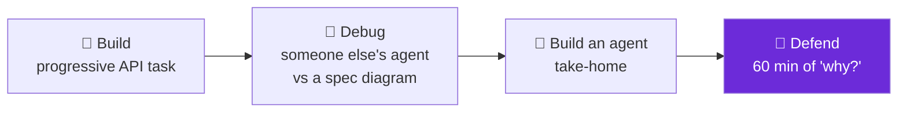

# Take-Homes, Repository Tasks and Work Trials

> A practical round has two halves: the thing you build, and how well you defend it. Most candidates prepare only the first.

Back to [README](../README.md) · [All questions](../questions/README.md)

*Last checked: 17 Nov 2026*

---

## What this tests in an interview

Whether you can do the job's actual work in a small, bounded form, and then explain it under questioning. AI-engineering loops use four shapes of practical round. They differ in time, setting and what gets graded, so find out which one you face before you prepare.

| Shape | Typical setting | What it really grades |
|---|---|---|
| **Timed repository task** | 45-90 min, live or async, inside an existing codebase | Reading unfamiliar code, small correct changes, tests, production hygiene |
| **Take-home build** | Days, async, your own tools (if allowed) | Scoping, working code, an eval, a clear README |
| **Agent build + presentation** | Take-home, then a live defence | Architecture and tool-calling choices you can justify; known failures |
| **Multi-day work trial** | 1-2+ days with the team | How you work: questions, pace, collaboration, a demo at the end |

The senior signal is the same in all four: a small thing that works and is measured, plus an honest list of what does not work yet. The junior tell is a large, polished demo with no tests, no numbers and no answer to "why this design?".

> [!WARNING]
> **"The take-home is the interview."** Often it is half. At Sierra (reported) the build is followed by a 60-minute session of "why" questions. Budget time for the defence: the decision log, the failure list, and a two-minute architecture sketch.

---

## Who runs what (and how sure we are)

Evidence labels: **official** (the company's own page), **first-person** (a candidate's own account), **second-hand** (an article or prep site). One candidate's account describes one process, not "the loop".

| Company | Practical round as described | Date | Evidence |
|---|---|---|---|
| **Sierra** (Software Engineer, Agent) | Progressive API coding on CoderPad (an API that fails then succeeds; then resolving products through fallback IDs). A debugging round: a 4-5 file agent codebase plus a diagram that is "your source of truth"; about 3 bugs. Then an agent take-home (an API key and a prompt to build an agent) and a 60-minute presentation with many "why" questions about architecture and tool calling. Python or TypeScript. About 2-3 weeks overall. ([gaijineer](https://gaijineer.co/sierra-software-engineer-agent-interview-experience)) | updated 9 Apr 2026 | first-person (anonymous candidate, published by a blog that collects such stories). Expected take-home hours, outcome and AI rules: not publicly confirmed. |
| **Cursor (Anysphere)** | Shortlisted candidates spend two days in the office on a real project with the team, join meals, and demo what they built at the end. First technical screens run without AI other than autocomplete. ([Business Insider](https://www.businessinsider.com/cursor-interview-process-no-ai-on-site-project-coding-tool-2025-6)) | 12 Jun 2025 | second-hand (reporting on the CEO's podcast remarks). Pay, AI rules during the trial, and whether this still holds: not publicly confirmed. |
| **Replit** | General process: recruiter, hiring manager, then a technical interview where you do a live or take-home exercise and review it with someone from the team (a project walkthrough, a coding challenge or a take-home assignment, by role), then a panel. ([Replit](https://replit.com/interview-process)) | read 17 Nov 2026 | official. AI-engineer specifics, durations and AI rules: not publicly confirmed. |
| **Anthropic** (SWE) | A prep site reports most people it spoke to took a 90-minute take-home on CodeSignal with a task that grows more complex; one reported task was a bank with several transaction types. It says the format is in flux. ([interviewing.io](https://interviewing.io/anthropic-interview-questions)) | published 7 Apr 2026, updated 13 May 2026 | second-hand. Official policy: take-homes are done without AI unless Anthropic says otherwise ([Anthropic](https://www.anthropic.com/candidate-ai-guidance), official, updated 10 Jul 2025). |

Related company pages: [Sierra](../company/sierra.md), [Replit](../company/replit.md), [Cursor](../company/cursor.md), [Anthropic](../company/anthropic.md), [Harvey](../company/harvey.md), [Glean](../company/glean.md), [Notion](../company/notion.md).

---

## The build-debug-defend pattern

The Sierra account shows a clean three-step pattern worth practising even if your target company never uses it:

| Step | What to practise | Common slip |
|---|---|---|
| **Build** (progressive) | Start with a correct minimal client. Add bounded retries and timeouts. Keep earlier behaviour working as each follow-up arrives | Hard-coding for part 1, then rewriting for part 3 |
| **Debug** (against a spec) | Map each state and transition in the diagram to code. Run the baseline. Fix one path, add a regression test, then the next | "Fixing" by changing the spec, or patching symptoms |
| **Build an agent** | A small tool set, typed tool inputs, a stop condition, logged traces, a few eval cases | A sprawling agent with ten tools and no measurement |
| **Defend** | Why this architecture, why these tools, why this model, what fails and how you know | Answering "why?" with "it's the standard way" |

> [!TIP]
> Keep a decision log while you build: one line per choice, with the option you rejected and why. It turns the defence from memory into reading notes, and it is the raw material for the "Design decisions" section of your README.

---

## How to scope a take-home

1. **Get the rules first** (see the recruiter questions below). Time budget, AI rules and review criteria change what "good" looks like.
2. **Write the success test before the code.** One sentence: "Given X, the agent does Y; I'll check it on N cases."
3. **Build the thinnest end-to-end path.** Input to output, running, before any polish.
4. **Add the eval next, not last.** 15-30 hand-written cases with a held-out split beats a pretty UI. A baseline (the simplest thing that could work) makes your numbers mean something.
5. **Spend the remaining time on the biggest failure.** Read the failing cases, fix the top category, re-run.
6. **Stop at the time budget.** Write down what you would do next instead of doing it. Going far over the budget can read as poor scoping, and it is unfair to you.

> [!WARNING]
> **"More features = better take-home."** Reviewers read your README and code in limited time. One core flow with tests and numbers beats five flows with none. If the brief lists stretch goals, do one well and name the rest under "next steps".

---

## What to hand in

| Item | What it contains | Template |
|---|---|---|
| **README** | One-line purpose, results table first, quick start that works from a fresh clone, how it works, design decisions, failures and limits, what's next | [project-readme.md](https://github.com/landedjobs/ai-engineer-portfolio-projects/blob/main/templates/project-readme.md) |
| **Tests** | Unit tests for the deterministic parts; a `make test` (or equivalent) that passes | |
| **Eval numbers** | What success means, the test set and split, how each case is graded (code vs LLM judge, and how the judge was checked), held-out results as "passed / total", cost, a failure review | [eval-report.md](https://github.com/landedjobs/ai-engineer-portfolio-projects/blob/main/templates/eval-report.md) |
| **Known limits** | At least three real failures, with what you would do about each | (section of the README template) |
| **Secrets hygiene** | No API keys in the repo; a `.env.example`; note which provided key you used and roughly what it cost | |
| **AI-use note** | If AI was allowed: what you used it for, and what you checked by hand. If not allowed: don't use it | |

For complete project walk-throughs (RAG, tool-using agent, MCP server, eval harness and more), see the portfolio repo's [guides](https://github.com/landedjobs/ai-engineer-portfolio-projects/tree/main/guides). For evaluation depth, see [Evals and LLM-as-judge](04-evals-and-llm-as-judge.md).

---

## How to present and defend it

The portfolio repo's [presenting-your-project.md](https://github.com/landedjobs/ai-engineer-portfolio-projects/blob/main/templates/presenting-your-project.md) lists the five questions almost every defence comes back to. Prepare a short answer to each:

| Question | A strong answer has |
|---|---|
| **Why this approach?** | The problem, the simpler option you rejected, and why |
| **Walk me through the architecture.** | A diagram drawn in under two minutes, data flow first |
| **How do you know it works?** | The test set, the grader, the baseline, the numbers |
| **What broke?** | Two real failures, how you found them, what you changed |
| **More time, or 10x traffic?** | Concrete next steps and where it breaks first |

For agent builds, expect the Sierra-style follow-ups: why tool calling over a fixed workflow, how tools are described to the model, what happens when a tool times out or returns junk, how the agent knows to stop, and how you would catch a regression after a prompt change. See [Agents and tool use](03-agents-and-tool-use.md).

> [!TIP]
> Lead the presentation with a live run of one case that works and one that fails. Showing the failure first-hand, with your explanation, earns more trust than any slide.

---

## Work trials

A multi-day trial (like Cursor's reported two-day project) tests how you work with a team, not just the output.

- **Before:** ask whether it is paid, what you will have access to (codebase, tools, AI assistants), and how the demo is judged.
- **Day 1:** ask questions early, agree a small scope with your host, ship something small by the end of the day.
- **Day 2:** finish one thing properly, rehearse the demo, keep a list of what you would do next.
- **Throughout:** say what you are stuck on. A trial is partly a check of whether people want to work with you.

---

## Questions to ask the recruiter

Ask these before you start. Getting the answers in writing avoids surprises.

1. **Time budget:** How long should this take? Is there a hard deadline or a soft one? Is going over held against me?
2. **AI rules:** Is AI allowed? Which tools? For the whole task or only parts? Will my prompts or session be recorded?
3. **Review criteria:** What will reviewers look at first: working code, tests, eval, README, or the presentation?
4. **Format of the review:** Is there a live walk-through or defence? How long, and with whom?
5. **Environment:** Which languages are allowed? Will I get an API key, and is there a spending limit?
6. **For work trials:** Is it paid? Remote or on site? What does the demo look like?

---

## 🔮 Representative practice prompts

Written for practice; none is a reported task from a named company.

### P1. Support agent take-home

> **Difficulty:** 🟡 Medium · **take-home** · 🔮 Representative

"Here is an API key and a mock orders API. Build an agent that answers order-status questions and can cancel an unshipped order. Budget: 4 hours. Present it in a 60-minute session."

Answer outline

- Scope: two tools, `get_order(id)` and `cancel_order(id)`, typed inputs, a confirmation step before cancel.
- Guardrails: cancel only if status is unshipped; never cancel without an explicit user yes; idempotent cancel.
- Eval: 20 cases (status lookups, cancellable, not cancellable, missing ID, prompt-injection in a note field), held-out split, deterministic checks on tool calls and final state.
- README: results table (passed / total vs a no-tools baseline), cost per conversation, three failures.
- Defence prep: why tool calling over a fixed flow; what happens when `get_order` times out; how you would detect a regression after a prompt edit.

### P2. Timed repository task

> **Difficulty:** 🟡 Medium · **repository task** · 🔮 Representative

"45 minutes. This repo ingests documents into a vector store. Add a source that pulls from a paginated REST API and stores new items only."

Answer outline

- First 5 minutes: run the tests, find the existing source interface, follow one document from fetch to store.
- Implement the smallest path: one page fetched, parsed and stored through the existing interface.
- Then pagination, retries with backoff and a cap, dedupe on a stable ID (not content hash alone), logs with request IDs.
- Tests: two pages, a duplicate across pages, a failing page that retries then succeeds.
- Say what is left: rate limits, partial failures mid-run, a backfill mode.

### P3. Debug the agent against the diagram

> **Difficulty:** 🔴 Hard · **debugging** · 🔮 Representative

"Here is a 5-file agent and a state diagram. A user who asks for a refund twice gets two refunds. Find and fix it."

Answer outline

- Map the diagram: states, transitions and which file owns each.
- Reproduce with a test that sends the refund request twice.
- Likely causes: refund state not saved before the tool call returns, or the tool lacks an idempotency key. Confirm with logs, not guessing.
- Fix at the right layer (state transition plus an idempotency key on the tool), add the regression test, re-run the rest.
- Explain why patching the prompt ("don't refund twice") is not a fix.

### P4. Defend a choice you would now change

> **Difficulty:** 🟢 Easy · **presentation** · 🔮 Representative

"In your take-home you used one large prompt with all tools. Would you do it again?"

Answer outline

- Answer honestly: what it bought (speed to a working version) and what it cost (tool confusion on N of M cases, from your eval).
- What you would try next (fewer tools per step, or a router), and how you would measure whether it helped.
- Interviewers usually reward a candid "I'd change this, here's the evidence" over defending every choice.

---

## Interview angles

- **"How did you decide what to leave out?"** → Point to the success test you wrote first, and the "next steps" list in your README.
- **"How do you know your agent works?"** → Held-out cases, a baseline, passed / total, and the failure review. Not "I tried a few things".
- **"What would break first at 10x?"** → Name the bottleneck (rate limits, cost per call, context size, a single lock) with a number.
- **"Did you use AI to build this?"** → Follow the stated rule. If it was allowed, say what you used it for and what you checked yourself.

---

## 📚 Resources

The four links below are from [landedjobs/ai-engineer-portfolio-projects](https://github.com/landedjobs/ai-engineer-portfolio-projects) (MIT, ~94★).

- 💻 [Project README template](https://github.com/landedjobs/ai-engineer-portfolio-projects/blob/main/templates/project-readme.md): results first, quick start, design decisions, failures and limits, plus a hand-in checklist.
- 💻 [Eval report template](https://github.com/landedjobs/ai-engineer-portfolio-projects/blob/main/templates/eval-report.md): success definition, test set, graders, held-out results, cost and failure review.
- 💻 [Presenting your project](https://github.com/landedjobs/ai-engineer-portfolio-projects/blob/main/templates/presenting-your-project.md): the five defence questions and how to link and describe a project.
- 💻 [Portfolio project guides](https://github.com/landedjobs/ai-engineer-portfolio-projects/tree/main/guides): ten build guides (RAG, tool-using agent, MCP server, eval harness and more) to practise the build half.
- 📰 [Sierra Software Engineer, Agent interview experience](https://gaijineer.co/sierra-software-engineer-agent-interview-experience): the build-debug-defend pattern from one candidate.
- 📰 [Business Insider: Cursor's hiring process](https://www.businessinsider.com/cursor-interview-process-no-ai-on-site-project-coding-tool-2025-6): the two-day team project, as reported in June 2025.
- 📘 [Replit interview process](https://replit.com/interview-process): an official example of a live or take-home exercise reviewed together.

---

Back to [README](../README.md) · [All questions](../questions/README.md) · Previous: [The AI-assisted coding round](10-ai-assisted-coding-round.md)
